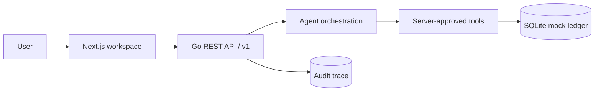

<p align="center">
  <a href="README.md">中文</a> · English
</p>

<p align="center">
  
</p>

<h3 align="center">Banking starts with a sentence.</h3>

<p align="center">
  A secure AI workspace for real banking operations<br />
  <sub>Understand intent. Govern execution. Prove the outcome.</sub>
</p>

<p align="center">
  
  
  
  
  
  
  
</p>

<p align="center">
  <a href="#product">Product</a>
  ·
  <a href="#security-model">Security</a>
  ·
  <a href="#product-film">Product film</a>
  ·
  <a href="#quick-start">Quick start</a>
  ·
  <a href="#documentation">Docs</a>
</p>

<p align="center">
  <a href="frontend/public/demo/vaultline-launch.mp4">
    
  </a>
</p>

<p align="center">
  <a href="frontend/public/demo/vaultline-launch.mp4"><strong>▶ Watch the 30-second launch film</strong></a>
  <br />
  <sub>30-second launch film · Real UI · Server-governed actions · Synthetic data only</sub>
</p>

> [!NOTE]
> The 30-second launch film is built with the huashu-motion code-animation workflow and a locally synthesized score. A separate 3-minute business demo is captured from the real Next.js frontend and Go API with Playwright. All accounts, balances, actions, and receipts are synthetic demo data.

## Product

Vaultline turns natural-language requests into reviewable banking actions. The model prepares a candidate plan; the bank server owns risk classification, authorization, MFA, the one-time execution gate, idempotency, audit, and the final receipt.

The product is designed as a regulated banking control surface, not a generic AI chat interface. A user can express intent, verify an immutable action snapshot, complete the required authorization, and receive a business outcome only when the bank service issues it.

<table>
  <tr>
    <td width="33%" valign="top">
      <sub>01 / UNDERSTAND</sub><br />
      <strong>Express complex intent naturally</strong><br />
      <sub>One workspace replaces deep menus and disconnected banking flows.</sub>
    </td>
    <td width="33%" valign="top">
      <sub>02 / GOVERN</sub><br />
      <strong>Review every action before execution</strong><br />
      <sub>Yellow actions require confirmation; red actions require action-bound MFA.</sub>
    </td>
    <td width="33%" valign="top">
      <sub>03 / PROVE</sub><br />
      <strong>Trust only the business receipt</strong><br />
      <sub>No invented balances, transaction IDs, yields, or successful outcomes.</sub>
    </td>
  </tr>
</table>

<p align="center">
  <code>Natural language</code> → <code>Server risk</code> → <code>Action snapshot</code> → <code>Confirmation / MFA</code> → <code>Server receipt</code>
</p>

## Core capabilities

| Capability | Example request | Server-owned evidence |
| --- | --- | --- |
| **Transfers** | “Transfer CNY 500 to Wang Ming for rent” | Action snapshot, risk level, Action ID, receipt |
| **Bill analysis** | “Where did I spend money this month?” | Category totals, anomaly explanations, Trace ID |
| **Investments** | “Compare conservative products and invest CNY 100” | Product/holding facts, risk class, MFA gate |
| **Card controls** | “Freeze the card ending in 8842” | Card state, authorization path, change history |
| **Subscriptions** | “Find unused subscriptions and cancel them” | Recurring-charge evidence, cancellation snapshot, audit |
| **Cross-scene workflows** | “Plan a birthday with a CNY 1,000 budget” | Child tasks, step-by-step authorization, receipts |
| **Liquidity preflight** | “Will reserving CNY 1,000 affect rent?” | Three cash-flow scenarios, daily curve, minimum balance, and safe budget |

## Security model

> The model may propose a plan. It cannot change permissions, bypass confirmation, open the execution gate, or declare a transaction successful.

| Level | Typical actions | Server control |
| --- | --- | --- |
| **Green** | Balances, transactions, bills, product queries | Execute after intent validation; return server facts only |
| **Yellow** | Small transfers, card freeze, subscription cancellation | Show an immutable action snapshot and wait for explicit confirmation |
| **Red** | Large transfers, card loss, investment purchase/redemption | Require MFA bound to the Action ID, then still enforce the execution gate |

- **Snapshot** — key fields are locked; any change requires a new action and a new authorization.
- **Idempotency** — confirmation and execution use idempotency keys to prevent duplicate side effects.
- **Audit** — decisions, authorization evidence, and receipts are linked by Trace ID with sensitive fields redacted.
- **Failure safety** — cancellation, expiry, MFA failure, insufficient balance, and unknown receipts have explicit states.
- **Run controls** — users can stop a run, hand it to a human, or roll back pending actions; executed money movements require review or compensation instead of silent reversal.
- **Channel adapter** — the web workspace and APP/IM gateways share the same Agent API through the controlled `/v1/channels/{channel}/messages` surface.

## Product film

The launch film follows one control line from intent to proof:

`natural language → immutable action → risk decision → Action-bound MFA → server receipt → audit trail`

The launch film rebuilds real workspace captures into motion shots and never fabricates UI, progress, or success states. The longer business demo preserves the working query, investment, card, subscription, liquidity, and workflow flows.

[Watch the 3-minute business demo](frontend/public/demo/vaultline-product.mp4) · See the [production plan](docs/demo-video-production.md) and the reusable [video pipeline](video/README.md).

<details>
<summary><strong>Architecture</strong></summary>

<br />



| Layer | Implementation |
| --- | --- |
| Product surface | Next.js 16 · TypeScript · responsive safety console |
| API and policy | Go · REST `/v1` · OpenAPI 3.1 |
| Agent boundary | Structured intent + server-approved tools |
| State and evidence | SQLite WAL · transactional ledger · idempotency · audit |

</details>

## Quick start

Requires Go 1.27+, Node.js 24.13+, pnpm 11, and CGO for the SQLite driver.

```bash
git clone https://github.com/cffa-as/bankagent.git
cd bankagent
```

Start the backend:

```bash
cd backend
go test ./...
go run ./cmd/bankagent
```

Start the frontend in another terminal:

```bash
cd frontend
nvm install
nvm use
corepack enable pnpm
pnpm install
pnpm dev
```

Open <http://localhost:3000>. The demo identity is `Bearer demo-user-1`; the mock MFA code is `000000`.

> [!IMPORTANT]
> This build uses only a local mock banking ledger. It has no real accounts, funds, SMS/biometric authentication, or core-banking integration. All demo data is synthetic.

## Documentation

| Document | Purpose |
| --- | --- |
| [Project introduction](docs/作品简介.md) | Submission-ready Chinese project introduction |
| [Product requirements](docs/产品需求.md) | Users, scenarios, capabilities, and interaction requirements |
| [High-level design](docs/概要设计.md) | Data model, API, database, and key flows |
| [OpenAPI](docs/openapi.yaml) | Shared machine-readable API contract |
| [Technical design](docs/技术方案.md) | Architecture, security boundaries, acceptance, and risks |
| [Competitive and technical evaluation](docs/竞品评测.md) | Executable metrics, public capability matrix, and reproduction steps |
| [Security self-assessment](docs/安全自评报告.md) | Permission model and known risks |
| [Brand direction](frontend/BRAND.md) | Vaultline visual direction and usage |
| [Video pipeline](video/README.md) | Capture, voiceover, and Remotion rendering workflow |

<p align="center">
  <sub>VAULTLINE · UNDERSTAND INTENT · GOVERN EXECUTION · PROVE THE OUTCOME</sub>
</p>
