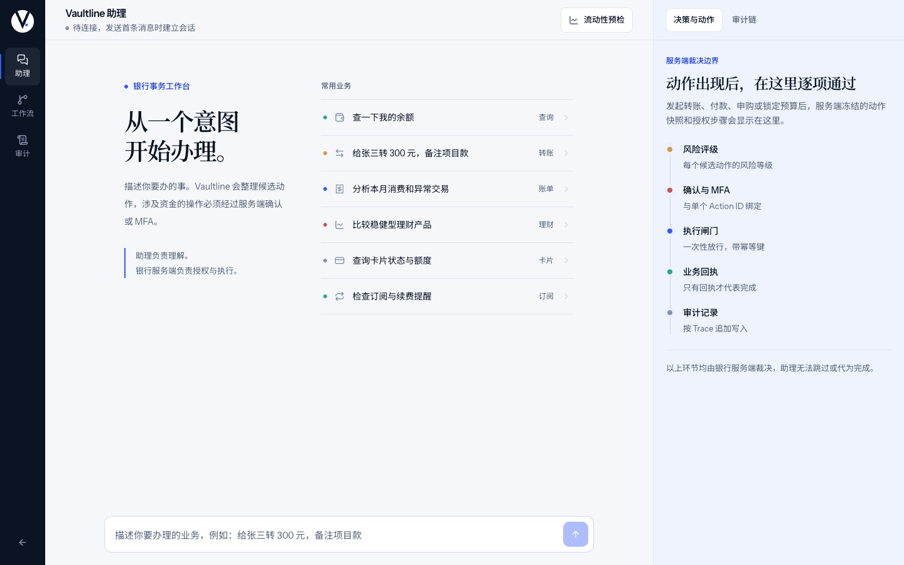
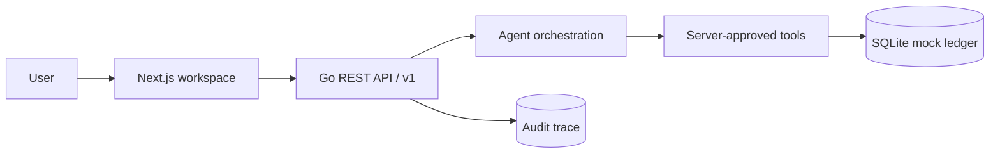

<p align="center">
  <a href="README.md">中文</a> · English
</p>

<p align="center">
  
</p>

<h1 align="center">Vaultline</h1>
<p align="center">
  <strong>Secure AI banking workspace</strong><br />
  Banking starts with a sentence.<br />
  <sub>The model proposes. The bank server decides.</sub>
</p>

<p align="center">
  
  
  
  
  
  
</p>

<p align="center">
  <a href="#product">Product</a>
  ·
  <a href="#security-model">Security</a>
  ·
  <a href="#product-film">Product demo</a>
  ·
  <a href="#quick-start">Quick start</a>
  ·
  <a href="#documentation">Docs</a>
</p>

<p align="center">
  <a href="frontend/public/demo/vaultline-product.mp4">
    
  </a>
</p>

<p align="center">
  <a href="frontend/public/demo/vaultline-product.mp4"><strong>▶ Watch the 3:46 product demo</strong></a>
  <br />
  <sub>Real UI · Real Go API · Server-governed actions · Synthetic data only</sub>
</p>

> [!NOTE]
> The product demo is captured automatically from the real Next.js frontend and Go API. All accounts, balances, actions, and receipts are synthetic demo data.

## Product

Vaultline turns natural-language requests into reviewable banking actions. The model prepares a candidate plan; the bank server owns risk classification, authorization, MFA, the one-time execution gate, idempotency, audit, and the final receipt.

The product is designed as a regulated banking control surface, not a generic AI chat interface. A user can express intent, verify an immutable action snapshot, complete the required authorization, and receive a business outcome only when the bank service issues it.

<table>
  <tr>
    <td width="33%" valign="top">
      <sub>01 / UNDERSTAND</sub><br />
      <strong>Express complex intent naturally</strong><br />
      <sub>One workspace replaces deep menus and disconnected banking flows.</sub>
    </td>
    <td width="33%" valign="top">
      <sub>02 / GOVERN</sub><br />
      <strong>Review every action before execution</strong><br />
      <sub>Yellow actions require confirmation; red actions require action-bound MFA.</sub>
    </td>
    <td width="33%" valign="top">
      <sub>03 / PROVE</sub><br />
      <strong>Trust only the business receipt</strong><br />
      <sub>No invented balances, transaction IDs, yields, or successful outcomes.</sub>
    </td>
  </tr>
</table>

<p align="center">
  <code>Natural language</code> → <code>Server risk</code> → <code>Action snapshot</code> → <code>Confirmation / MFA</code> → <code>Server receipt</code>
</p>

## Core capabilities

| Capability | Example request | Server-owned evidence |
| --- | --- | --- |
| **Transfers** | “Transfer CNY 500 to Wang Ming for rent” | Action snapshot, risk level, Action ID, receipt |
| **Bill analysis** | “Where did I spend money this month?” | Category totals, anomaly explanations, Trace ID |
| **Investments** | “Compare conservative products and invest CNY 100” | Product/holding facts, risk class, MFA gate |
| **Card controls** | “Freeze the card ending in 8842” | Card state, authorization path, change history |
| **Subscriptions** | “Find unused subscriptions and cancel them” | Recurring-charge evidence, cancellation snapshot, audit |
| **Cross-scene workflows** | “Plan a birthday with a CNY 1,000 budget” | Child tasks, step-by-step authorization, receipts |
| **Liquidity preflight** | “Will reserving CNY 1,000 affect rent?” | Three cash-flow scenarios, daily curve, minimum balance, and safe budget |

## Security model

> The model may propose a plan. It cannot change permissions, bypass confirmation, open the execution gate, or declare a transaction successful.

| Level | Typical actions | Server control |
| --- | --- | --- |
| **Green** | Balances, transactions, bills, product queries | Execute after intent validation; return server facts only |
| **Yellow** | Small transfers, card freeze, subscription cancellation | Show an immutable action snapshot and wait for explicit confirmation |
| **Red** | Large transfers, card loss, investment purchase/redemption | Require MFA bound to the Action ID, then still enforce the execution gate |

- **Snapshot** — key fields are locked; any change requires a new action and a new authorization.
- **Idempotency** — confirmation and execution use idempotency keys to prevent duplicate side effects.
- **Audit** — decisions, authorization evidence, and receipts are linked by Trace ID with sensitive fields redacted.
- **Gateway auth** — the server validates a configurable bearer token in constant time; a same-origin Next.js proxy injects it, so browser code never holds the service token.
- **Failure safety** — cancellation, expiry, MFA failure, insufficient balance, and unknown receipts have explicit states.
- **Run controls** — users can stop a run, hand it to a human, or roll back pending actions; executed money movements require review or compensation instead of silent reversal.
- **Channel adapter** — the web workspace and APP/IM gateways share the same Agent API through the controlled `/v1/channels/{channel}/messages` surface.

## Evaluation

Evaluation is deliberately separated from ordinary unit tests: unit tests cover pure rules, a tagged `integration` suite covers the real HTTP handler and SQLite transaction layer, and Playwright covers the built browser workspace against the real Go API.

| Experiment | Size | Result |
| --- | ---: | --- |
| Intent classification | 64 cases / 10 classes | 100% accuracy, 1.000 macro-F1, 1.000 Cohen's κ |
| Slot extraction | 10 cases | 100% exact match, 0 amount MAE |
| Risk policy | 20 boundary cases | Red precision / recall / F1 all 1.000 |
| Security robustness | 24 attacks + 24 benign cases | 0% ASR, 0% FPR, 100% policy compliance |
| Replay / concurrency | 12 + 16 | 0 duplicate side effects, 1 winner / 15 conflicts |
| Browser E2E | 8 real journeys | 8 / 8 passed, 0 console errors, 0 HTTP 5xx |
| Latency | 200 warm HTTP requests | p50 413 µs, p95 599 µs, p99 2498 µs |

See the [HTML evaluation report](evaluation/results/academic-report.html) for confusion matrices, confidence intervals, latency CDF, and the complete case ledger. Raw artifacts are in [academic.json](evaluation/results/academic.json) and [cases.csv](evaluation/results/cases.csv).

## Product demo

The full demo follows one control line from intent to proof:

`natural language → immutable action → risk decision → Action-bound MFA → server receipt → audit trail`

The demo uses real workspace captures and real server states. It never fabricates UI, progress, or success outcomes. The current cut covers queries, bills, investments, cards, subscriptions, liquidity, workflows, confirmation, MFA, and audit.

[Watch the full business demo](frontend/public/demo/vaultline-product.mp4).

<details>
<summary><strong>Architecture</strong></summary>

<br />



| Layer | Implementation |
| --- | --- |
| Product surface | Next.js 16 · TypeScript · responsive safety console |
| API and policy | Go · REST `/v1` · OpenAPI 3.1 |
| Agent boundary | Structured intent + server-approved tools |
| State and evidence | SQLite WAL · transactional ledger · idempotency · audit |

</details>

## Quick start

Requires Go 1.27+, Node.js 24.13+, pnpm 11, and CGO for the SQLite driver.

```bash
git clone https://github.com/cffa-as/bankagent.git
cd bankagent
```

Start the backend:

```bash
cd backend
go test ./...
go run ./cmd/bankagent
```

Start the frontend in another terminal:

```bash
cd frontend
nvm install
nvm use
corepack enable pnpm
pnpm install
pnpm dev
```

Open <http://localhost:3000>. Local development defaults to `BANKAGENT_AUTH_TOKEN=demo-user-1`; the mock MFA code is `000000`.
For shared environments, set a random `BANKAGENT_AUTH_TOKEN` of at least 24 characters. The same-origin Next.js `/backend` proxy injects it server-side, so the token is not sent to the browser.
Set `BANKAGENT_MFA_CODE` to replace the local six-digit MFA test code.

> [!IMPORTANT]
> This build uses only a local mock banking ledger. It has no real accounts, funds, SMS/biometric authentication, or core-banking integration. All demo data is synthetic.

## Documentation

| Document | Purpose |
| --- | --- |
| [Technical dossier](docs/submission/Vaultline-技术文档.pdf) | Architecture, core algorithms, security design, and evaluation evidence |
| [Presentation](docs/submission/Vaultline-答辩材料.pptx) | 14-slide technical presentation with editable charts and diagrams |
| [Source and deployment package](docs/submission/Vaultline-源代码与部署材料.zip) | README, source, deployment instructions, tests, and OpenAPI |
| [Security self-assessment](docs/submission/Vaultline-安全自评报告.pdf) | Permission model and known-risk register |
| [OpenAPI](backend/api/openapi.yaml) | Shared machine-readable API contract |
| [Evaluation report](evaluation/results/academic-report.html) | Integration/E2E metrics, confusion matrices, confidence intervals, and the complete case ledger |

<p align="center">
  <sub>VAULTLINE · UNDERSTAND INTENT · GOVERN EXECUTION · PROVE THE OUTCOME</sub>
</p>
