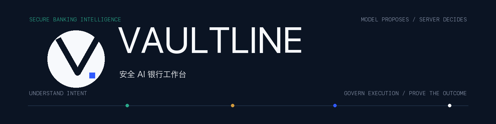
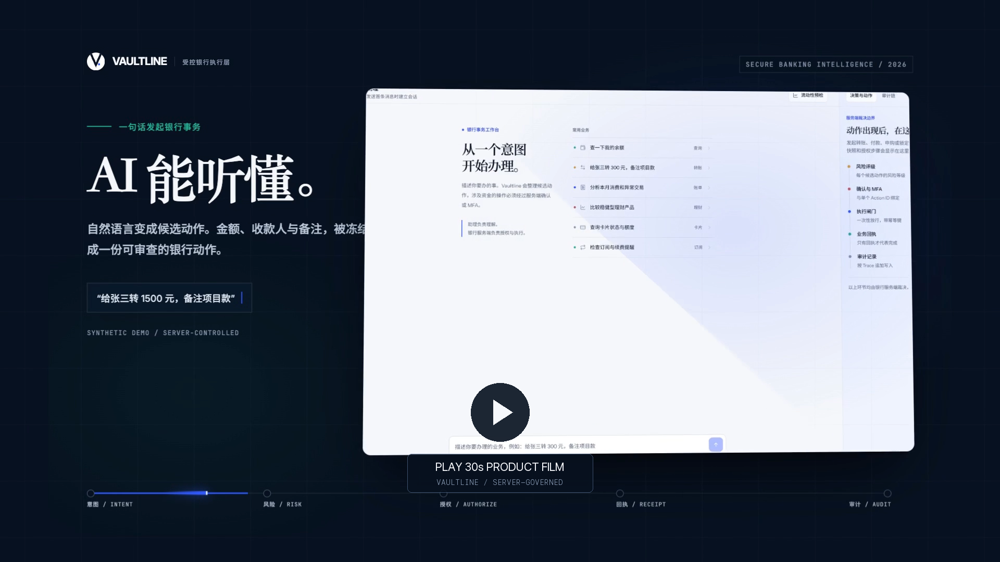
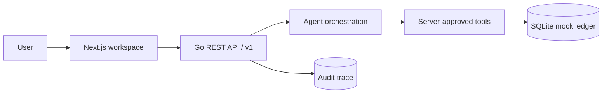

<p align="center">
  <a href="README.md">中文</a> · <a href="README.en.md">English</a>
</p>

<p align="center">
  
</p>

<h3 align="center">让银行业务，一句话开始。</h3>

<p align="center">
  面向真实银行业务的安全 AI 工作台<br />
  <sub>Secure banking intelligence where the server remains in control.</sub>
</p>

<p align="center">
  
  
  
  
  
  
  
</p>

<p align="center">
  <a href="#product">产品</a>
  ·
  <a href="#security-model">安全模型</a>
  ·
  <a href="#product-film">产品视频</a>
  ·
  <a href="#quick-start">快速开始</a>
  ·
  <a href="#documentation">文档</a>
</p>

<p align="center">
  <a href="frontend/public/demo/vaultline-launch.mp4">
    
  </a>
</p>

<p align="center">
  <a href="frontend/public/demo/vaultline-launch.mp4"><strong>▶ 观看 30 秒产品宣传片</strong></a>
  <br />
  <sub>30-second launch film · Real UI · Server-governed actions · Synthetic data only</sub>
</p>

> [!NOTE]
> 30 秒品牌片由 huashu-motion 的代码化动画流程生成，配乐和音效在本地合成；3 分钟业务演示由 Playwright 驱动真实前端和 Go API 录制。所有账户、金额、动作与回执均为合成演示数据。

<a id="product"></a>

## 产品 / Product

Vaultline 把自然语言请求转化为可审查的银行动作。模型负责理解意图、提取实体和准备候选计划；风险分级、用户确认、MFA、执行门、幂等、审计和最终回执始终由银行服务端掌握。

Vaultline turns natural-language requests into reviewable banking actions. The model prepares a candidate plan; the bank server owns risk classification, authorization, MFA, the execution gate, idempotency, audit, and the final receipt.

<table>
  <tr>
    <td width="33%" valign="top">
      <sub>01 / UNDERSTAND</sub><br />
      <strong>一句话表达复杂需求</strong><br />
      <sub>自然语言进入统一工作台，不需要记住深层菜单和功能入口。</sub>
    </td>
    <td width="33%" valign="top">
      <sub>02 / GOVERN</sub><br />
      <strong>每个动作先审查再执行</strong><br />
      <sub>关键字段锁定为动作快照；黄色确认，红色 Action-bound MFA。</sub>
    </td>
    <td width="33%" valign="top">
      <sub>03 / PROVE</sub><br />
      <strong>最终结果只认业务回执</strong><br />
      <sub>页面不伪造余额、交易号或收益；状态变化关联 Trace ID。</sub>
    </td>
  </tr>
</table>

<p align="center">
  <code>Natural language</code> → <code>Server risk</code> → <code>Action snapshot</code> → <code>Confirmation / MFA</code> → <code>Server receipt</code>
</p>

## 核心能力 / Core capabilities

| Capability | 用户可以直接说 | 服务端必须给出 |
| --- | --- | --- |
| **智能转账 / Transfers** | “转 500 元给王明，备注房租” | 动作快照、风险等级、Action ID、执行回执 |
| **账单分析 / Bill analysis** | “看看这个月钱花在哪了” | 分类统计、异常交易解释、Trace ID |
| **理财操作 / Investments** | “比较稳健型产品，申购 100 元” | 产品/持仓事实、风险分级、MFA 执行门 |
| **卡片管理 / Card controls** | “冻结尾号 8842 的卡” | 卡片状态、授权路径、变更记录 |
| **订阅代扣 / Subscriptions** | “找出不用的订阅并取消” | 周期扣费证据、取消快照、可审计结果 |
| **跨场景联动 / Cross-scene** | “预算 1000 元安排爱人生日” | 子任务工作流、逐项授权、业务回执 |
| **流动性预检 / Liquidity preflight** | “锁定 1000 元会影响房租吗” | 三种现金流情景、逐日曲线、最低余额和安全预算 |

<a id="security-model"></a>

## 安全模型 / Security model

> 模型可以提出计划，但不能修改权限、绕过确认、开启执行门，也不能宣布交易成功。

| Level | 典型动作 | 服务端控制 |
| --- | --- | --- |
| **Green** | 余额、流水、账单、产品查询 | 意图确认后自动执行；只返回服务端事实 |
| **Yellow** | 小额转账、冻结卡片、订阅取消、虚拟卡申请 | 展示不可静默修改的动作快照，等待显式确认 |
| **Red** | 大额转账、卡片挂失/解挂、理财申购/赎回 | 必须通过绑定 Action ID 的 MFA；通过后仍需执行门 |

- **Snapshot / 动作快照**：金额、收款人、产品等关键字段锁定；变化必须创建新动作并重新授权。
- **Idempotency / 幂等**：确认与执行支持幂等键，同一请求只能产生一次副作用。
- **Audit / 审计**：决策链、授权证据和业务回执通过 Trace ID 关联，敏感字段脱敏。
- **Failure-safe / 失败安全**：取消、过期、MFA 失败、余额不足和未知回执都有明确状态，不盲目重试。

<a id="product-film"></a>

## 产品视频 / Product film

30 秒品牌片用一条控制线贯穿从意图到回执的核心链路：

`自然语言输入 → 动作快照 → 风险判定 → Action-bound MFA → 业务回执 → 审计追踪`

品牌片使用真实工作台截图和真实服务端状态重新编排，不伪造界面、进度或成功结果。完整的 3 分钟业务演示保留了查询、理财、卡片、订阅、流动性预演和工作流等逐项操作。

The 30-second launch film is built with the huashu-motion code-animation workflow and a locally synthesized score. The separate 3-minute business demo is captured from the real Next.js UI and Go API. All funds, balances, and receipts are synthetic.

[观看 3 分钟完整业务演示](frontend/public/demo/vaultline-product.mp4) · 制作流程见 [产品演示视频方案](docs/demo-video-production.md)，可复用工程见 [`video/`](video/README.md)。

<details>
<summary><strong>Architecture / 架构</strong></summary>

<br />



| Layer | Implementation |
| --- | --- |
| Product surface | Next.js 16 · TypeScript · responsive safety console |
| API and policy | Go · REST `/v1` · OpenAPI 3.1 |
| Agent boundary | Structured intent + server-approved tools |
| State and evidence | SQLite WAL · transactional ledger · idempotency · audit |

</details>

<a id="quick-start"></a>

## 快速开始 / Quick start

需要 Go 1.27+、Node.js 24.13+、pnpm 11 和 CGO（SQLite 驱动）。

```bash
git clone https://github.com/cffa-as/bankagent.git
cd bankagent
```

启动后端：

```bash
cd backend
go test ./...
go run ./cmd/bankagent
```

另开终端启动前端：

```bash
cd frontend
nvm install
nvm use
corepack enable pnpm
pnpm install
pnpm dev
```

打开 <http://localhost:3000>。演示身份为 `Bearer demo-user-1`，演示 MFA 验证码为 `000000`。

> [!IMPORTANT]
> 当前版本只连接本地 Mock 银行账本。没有真实账户、真实资金、真实短信/人脸认证或银行核心系统接入；所有演示数据均为合成数据。

<a id="documentation"></a>

## 文档 / Documentation

| Document | Purpose |
| --- | --- |
| [产品需求](docs/产品需求.md) | 用户、场景、功能和交互要求 |
| [概要设计](docs/概要设计.md) | 数据模型、API、数据库和关键流程 |
| [OpenAPI](docs/openapi.yaml) | 前后端共同遵循的机器可读契约 |
| [技术方案](docs/技术方案.md) | 架构、安全边界、验收和风险 |
| [竞品与技术评测](docs/竞品评测.md) | 可执行指标、竞品能力矩阵和复现方式 |
| [安全自评报告](docs/安全自评报告.md) | 权限分级实现说明与已知风险 |
| [品牌规范](frontend/BRAND.md) | Vaultline 视觉方向、标识和用色 |
| [视频工程](video/README.md) | 录屏、旁白、Remotion 渲染流程 |

<p align="center">
  <sub>VAULTLINE · UNDERSTAND INTENT · GOVERN EXECUTION · PROVE THE OUTCOME</sub>
</p>
