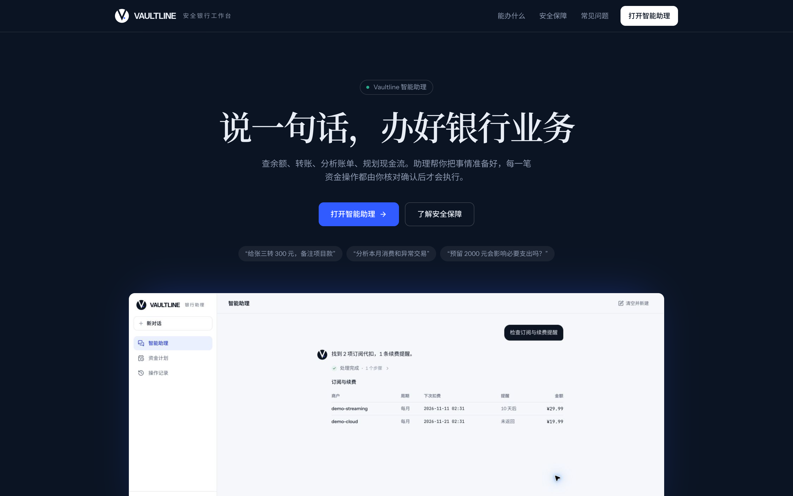
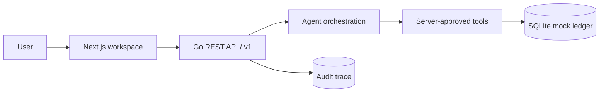

<p align="center">
  <a href="README.md">中文</a> · <a href="README.en.md">English</a>
</p>

<p align="center">
  
</p>

<h1 align="center">Vaultline</h1>
<p align="center">
  <strong>安全 AI 银行工作台</strong><br />
  让银行业务，一句话开始。<br />
  <sub>模型提议，银行服务端裁决。</sub>
</p>

<p align="center">
  
  
  
  
  
  
</p>

<p align="center">
  <a href="#product">产品</a>
  ·
  <a href="#security-model">安全模型</a>
  ·
  <a href="#quick-start">快速开始</a>
  ·
  <a href="#documentation">文档</a>
</p>

<p align="center">
  
</p>

<p align="center">
  <sub>官网首页 / Landing page</sub>
</p>

<p align="center">
  
</p>

<p align="center">
  <sub>真实工作台 / Safety workspace</sub>
</p>

<p align="center">
  <a href="https://github.com/cffa-as/bankagent/raw/refs/heads/main/frontend/public/demo/vaultline-product.mp4"><strong>▶ 播放完整产品演示 · 4:58</strong></a>
  <br />
  <sub>真实前端 · 真实 Go API · Synthetic data only</sub>
</p>

> [!NOTE]
> 产品演示由真实前端和 Go API 自动录制生成。所有账户、金额、动作与回执均为合成演示数据。

<a id="product"></a>

## 产品 / Product

Vaultline 把自然语言请求转化为可审查的银行动作。模型负责理解意图、提取实体和准备候选计划；风险分级、用户确认、MFA、执行门、幂等、审计和最终回执始终由银行服务端掌握。

Vaultline turns natural-language requests into reviewable banking actions. The model prepares a candidate plan; the bank server owns risk classification, authorization, MFA, the execution gate, idempotency, audit, and the final receipt.

<table>
  <tr>
    <td width="33%" valign="top">
      <sub>01 / UNDERSTAND</sub><br />
      <strong>一句话表达复杂需求</strong><br />
      <sub>自然语言进入统一工作台，不需要记住深层菜单和功能入口。</sub>
    </td>
    <td width="33%" valign="top">
      <sub>02 / GOVERN</sub><br />
      <strong>每个动作先审查再执行</strong><br />
      <sub>关键字段锁定为动作快照；黄色确认，红色 Action-bound MFA。</sub>
    </td>
    <td width="33%" valign="top">
      <sub>03 / PROVE</sub><br />
      <strong>最终结果只认业务回执</strong><br />
      <sub>页面不伪造余额、交易号或收益；状态变化关联 Trace ID。</sub>
    </td>
  </tr>
</table>

<p align="center">
  <code>Natural language</code> → <code>Server risk</code> → <code>Action snapshot</code> → <code>Confirmation / MFA</code> → <code>Server receipt</code>
</p>

## 核心能力 / Core capabilities

| Capability | 用户可以直接说 | 服务端必须给出 |
| --- | --- | --- |
| **智能转账 / Transfers** | “转 500 元给王明，备注房租” | 动作快照、风险等级、Action ID、执行回执 |
| **账单分析 / Bill analysis** | “看看这个月钱花在哪了” | 分类统计、异常交易识别（大额偏离 / 凌晨交易 / 重复扣款 / 首次商户）、Trace ID |
| **理财操作 / Investments** | “比较稳健型产品，申购 100 元” | 产品/持仓事实、风险分级、MFA 执行门 |
| **卡片管理 / Card controls** | “冻结尾号 8842 的卡” | 卡片状态、授权路径、变更记录 |
| **订阅代扣 / Subscriptions** | “找出不用的订阅并取消” | 周期扣费证据、取消快照、可审计结果 |
| **跨场景联动 / Cross-scene** | “预算 1000 元安排爱人生日” | 子任务工作流、逐项授权、业务回执 |
| **流动性预检 / Liquidity preflight** | “锁定 1000 元会影响房租吗” | 三种现金流情景、逐日曲线、最低余额和安全预算 |

<a id="security-model"></a>

## 安全模型 / Security model

> 模型可以提出计划，但不能修改权限、绕过确认、开启执行门，也不能宣布交易成功。

| Level | 典型动作 | 服务端控制 |
| --- | --- | --- |
| **Green** | 余额、流水、账单、产品查询 | 意图确认后自动执行；只返回服务端事实 |
| **Yellow** | 小额转账、冻结卡片、订阅取消、虚拟卡申请 | 展示不可静默修改的动作快照，等待显式确认 |
| **Red** | 大额转账、卡片挂失/解挂、理财申购/赎回 | 必须通过绑定 Action ID 的 MFA；通过后仍需执行门 |

- **Snapshot / 动作快照**：金额、收款人、产品等关键字段锁定；变化必须创建新动作并重新授权。
- **Idempotency / 幂等**：确认与执行支持幂等键，同一请求只能产生一次副作用。
- **Audit / 审计**：决策链、授权证据和业务回执通过 Trace ID 关联，敏感字段脱敏。
- **Gateway auth / 网关认证**：服务端使用配置化 Bearer Token 和常量时间比较；前端同源代理注入，浏览器不持有服务令牌。
- **Failure-safe / 失败安全**：取消、过期、MFA 失败、余额不足和未知回执都有明确状态，不盲目重试。
- **Run controls / 运行控制**：支持停止当前运行、转人工接管，以及撤销待执行动作；已执行资金动作只能进入人工复核或补偿，不能被静默冲正。
- **Channel adapter / 渠道适配**：Web 工作台复用同一 Agent API；APP 与 IM 网关可通过受控的 `/v1/channels/{channel}/messages` 入口接入。
- **Input boundary / 输入边界**：进入意图解析前移除零宽、双向控制和 Unicode 标签字符；高置信注入指令直接拒绝，不创建 Action。
- **Trust passport / 可信执行凭证**：动作响应由服务端附带 Source、Identity、Receipt 三类证据；前端不能自行推导授权或成功。
- **MFA state / 安全验证状态**：红色动作只展示服务端返回的失败次数、剩余尝试次数和锁定状态；验证码通过后仍需通过一次性执行门。

安全设计对齐 [《关于银行业保险业人工智能安全开发应用的指导意见》](https://www.news.cn/tech/20260618/52e251c6c92a4059bae3936266172a6e/c.html)、
[《人工智能安全治理框架》2.0 版](https://www.cac.gov.cn/2025-09/15/c_1759653448369123.htm) 与
[OWASP GenAI LLM Top 10 2026](https://github.com/GenAI-Security-Project/GenAI-LLM-Top10) 的风险分类和生命周期治理思路。

## 测评 / Evaluation

测评不是把单测换个名字。项目分成三层：普通单元测试、带 `integration` 标签的 API/SQLite 集成评测，以及 Playwright 驱动的真实浏览器 E2E。

| 实验 | 规模 | 结果 |
| --- | ---: | --- |
| Intent classification | 64 条 / 10 类 | Accuracy 100%，Macro-F1 1.000，Cohen's κ 1.000 |
| Slot extraction | 10 条 | Exact match 100%，amount MAE 0 |
| Risk policy | 20 条边界用例 | Red Precision / Recall / F1 均为 1.000 |
| Security robustness | 24 攻击 + 24 良性 | ASR 0%，FPR 0%，Policy compliance 100% |
| Replay / concurrency | 12 + 16 | 重复副作用 0，并发确认 1 成功 / 15 冲突 |
| Browser E2E | 9 条真实业务链路 | 9 / 9 通过，console error 0，HTTP 5xx 0 |
| Latency | 200 次 warm HTTP | p50 413 µs，p95 599 µs，p99 2498 µs |

完整指标、混淆矩阵、置信区间、延迟 CDF 和全部用例明细见 [HTML 测评报���](evaluation/results/academic-report.html)。原始数据见 [academic.json](evaluation/results/academic.json) 与 [cases.csv](evaluation/results/cases.csv)。

<details>
<summary><strong>Architecture / 架构</strong></summary>

<br />



| Layer | Implementation |
| --- | --- |
| Product surface | Next.js 16 · TypeScript · responsive safety console |
| API and policy | Go · REST `/v1` · OpenAPI 3.1 |
| Agent boundary | Structured intent + server-approved tools |
| State and evidence | SQLite WAL · transactional ledger · idempotency · audit |

</details>

<a id="quick-start"></a>

## 快速开始 / Quick start

需要 Go 1.27+、Node.js 24.13+、pnpm 11 和 CGO（SQLite 驱动）。

```bash
git clone https://github.com/cffa-as/bankagent.git
cd bankagent
```

启动后端：

```bash
cd backend
go test ./...
go run ./cmd/bankagent
```

另开终端启动前端：

```bash
cd frontend
nvm install
nvm use
corepack enable pnpm
pnpm install
pnpm dev
```

打开 <http://localhost:3000>。本地默认使用 `BANKAGENT_AUTH_TOKEN=demo-user-1`，演示 MFA 验证码为 `000000`。
共享环境请设置至少 24 位随机 `BANKAGENT_AUTH_TOKEN`，并由前端 `/backend` 同源代理注入，令牌不会下发到浏览器。
`BANKAGENT_MFA_CODE` 可替换本地 MFA 测试验证码，必须为 6 位数字。

> [!IMPORTANT]
> 当前版本只连接本地 Mock 银行账本。没有真实账户、真实资金、真实短信/人脸认证或银行核心系统接入；所有演示数据均为合成数据。

<a id="documentation"></a>

## 文档 / Documentation

| Document | Purpose |
| --- | --- |
| [技术文档](docs/submission/Vaultline-技术文档.pdf) | 系统架构、核心算法、安全设计与评测证据 |
| [答辩材料](docs/submission/Vaultline-答辩材料.pptx) | 14 页答辩演示，图表和架构均可编辑 |
| [源代码与部署材料](docs/submission/Vaultline-源代码与部署材料.zip) | README、源码、部署说明、测试与 OpenAPI |
| [安全自评报告](docs/submission/Vaultline-安全自评报告.pdf) | 权限分级实现说明与已知风险清单 |
| [OpenAPI](backend/api/openapi.yaml) | 前后端共同遵循的机器可读契约 |
| [完整测评报告](evaluation/results/academic-report.html) | 集成/E2E 指标、混淆矩阵、置信区间和完整用例明细 |

<p align="center">
  <sub>VAULTLINE · UNDERSTAND INTENT · GOVERN EXECUTION · PROVE THE OUTCOME</sub>
</p>
