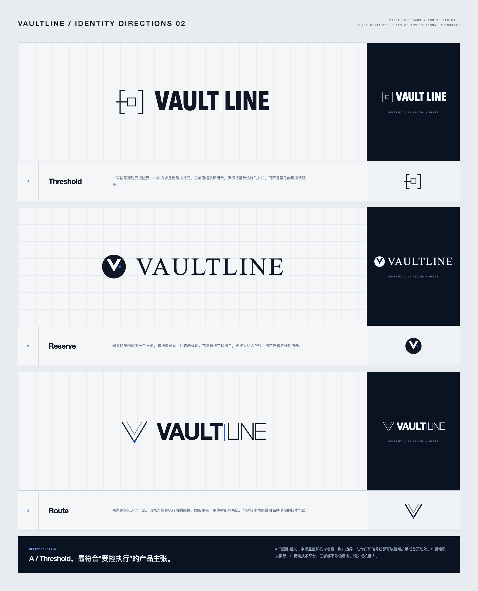

## 04 · Security-grade terminal（当前修订版）

- Preview: https://p.superdesign.dev/draft/6913984f-aec9-4a7f-9e88-2bfb31e68251
- 本轮改为冷白/铂金灰、深海军蓝和克制钴蓝，突出安全性、专业性和高级感。
- 已清理生成器自动添加的 AML/KYC、历史模式匹配、可用余额、生产环境等未经回执证明的内容，并恢复精确的演示 Action ID。

## 05 · Vaultline logo directions

- A / Threshold：受控边界与执行门，推荐用于“银行基础设施”定位。
- B / Reserve：圆形负空间 V，偏私人银行、资产托管和长期信任。
- C / Route：双路径汇入回执点，偏技术平台和智能体系统。
- 三套方案均为 `VAULTLINE` 字标加一个可延展的抽象图形，未使用盾牌、锁头或机器人。
- 当前仍是概念稿，确认方向后再输出颜色、反白、透明 PNG、图标和完整品牌资产。
