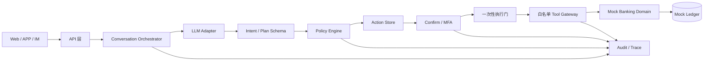
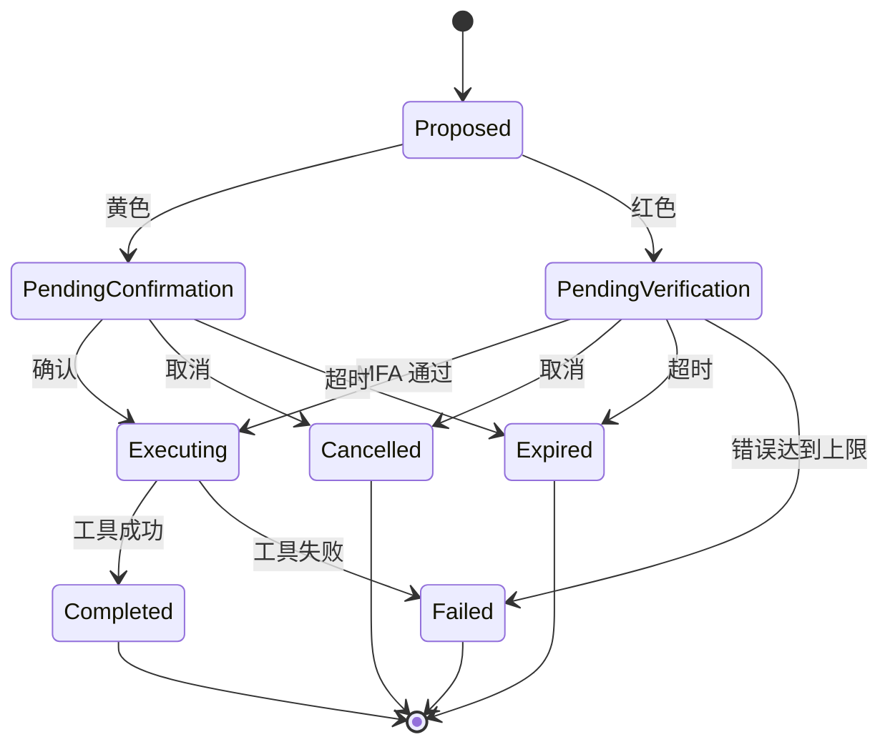

# 银行 AI 智能体技术方案（评审稿）

> 版本：v0.2
> 状态：待评审，暂不进入实现
> 关联文档：[赛题解析](赛题解析.md)、[竞品与参考实现](竞品与参考实现.md)

## 1. 方案摘要

bankagent 是一个安全优先、可审计、可演示的银行 AI 智能体。用户用自然语言描述需求，系统完成意图理解、信息补全、任务规划、风险判断、用户授权和业务执行。

首期只做三个场景：

- 智能转账：查询、黄色小额确认、红色大额 MFA、幂等执行。
- 账单分析：分类统计、月度汇总、异常交易和可解释报告。
- 理财操作：产品推荐与对比、风险提示、红色申购/赎回流程。

演示使用独立 Mock 银行账本。模型只负责理解和规划；权限、金额、身份、执行和结果由服务端与业务工具负责。

## 2. 目标与边界

### 2.1 目标

- 用户能用一句话查询信息或发起业务动作。
- 关键信息缺失时追问，不猜测金额、收款人或产品。
- 黄色和红色动作在执行前展示可核对的详情。
- 查询和业务回执都可按 Trace ID 追溯。
- 取消、过期、失败、重复提交和提示注入都能稳定处理。

### 2.2 非目标

首期不接入真实银行核心系统、真实资金交易、生产级身份认证、人脸/短信/U 盾，也不允许大模型生成和执行任意代码。卡片、订阅和跨场景联动留作后续扩展。

## 3. 核心交互

交互规则：意图不清只追问；黄色/红色动作确认后不能改关键字段；执行前重新计算风险、余额和状态；最终结果只使用工具回执。

## 4. 首期场景与验收

### 4.1 智能转账

支持“给张三转 300 元，备注房租”“今天还能转多少”等表达。系统抽取收款人、金额和备注，按“当日已成功转出金额 + 本次金额”判断累计额度。

- 预计日累计 ≤ 1000 元：黄色，展示详情并明确确认。
- 预计日累计 > 1000 元：红色，完成动作绑定的 MFA。
- 创建动作和最终执行前都重新计算，避免时间差绕过策略。
- 重复确认只执行一次；取消、过期、余额不足或工具失败不改变账户。

验收：当天已转 800 元再转 300 元必须升级红色；验证码连续错误 3 次锁定；同一动作重复提交不重复扣款。

### 4.2 账单分析

支持本月支出、分类占比、最高消费类别和异常交易查询。数字全部来自账本工具；没有数据时返回空态。

首期异常规则只做可解释的演示规则，例如大额偏离历史均值、夜间高额消费。规则结果需要携带依据，不把模型猜测写成事实。

验收：分类合计与明细一致；无异常时明确返回未发现；异常报告能指出交易、规则和原因。

### 4.3 理财操作

支持按风险偏好推荐和对比 Mock 产品，展示风险等级、期限、起购金额和业绩比较基准。申购和赎回均按红色处理，执行前校验余额、起购金额和风险确认。

验收：不推荐不存在的产品、不承诺收益；未完成 MFA 不改变账户；余额不足时返回工具失败和不变更证据。

## 5. 系统架构

| 组件 | 负责 | 不负责 |
| --- | --- | --- |
| API/渠道 | 会话接入、展示、确认和验证码输入 | 风险判断、资金操作 |
| Orchestrator | 上下文、追问、任务状态和人工接管 | 直接拼接业务成功结果 |
| LLM Adapter | 意图、实体和候选计划 | 授权、密钥、风险等级、工具直连 |
| Schema Validator | 校验结构和允许的计划节点 | 接受模型自定义工具 |
| Policy Engine | 风险级别、日累计、二次复核 | 读取用户 Prompt 作为授权依据 |
| Confirm/MFA | 动作绑定、确认、过期和错误次数 | 依赖前端做最终校验 |
| Tool Gateway | 工具白名单、参数校验、幂等 | 任意 SQL、Shell 或内部接口 |
| Banking Domain | 账本、转账、账单、理财规则和回执 | 信任模型原始参数 |
| Audit/Trace | 追加式决策与执行事件 | 代替授权证据或业务回执 |

首期采用轻量编排层和明确数据契约；赛题的关键是安全闭环，不需要先引入重型 Agent 框架。

## 6. 意图理解与任务规划

模型输出固定结构，例如 `intent`、`entities`、`missing_fields`、`plan` 和 `user_facing_question`，由 Schema 校验后才进入服务端。解析失败、置信度不足或字段冲突时追问或降级为查询，不执行副作用。

任务计划使用有限节点和依赖关系表达 DAG。首期只需要覆盖“查余额 → 风险判断 → 确认/MFA → 执行 → 回执”这类固定链路；复杂任务先保存计划和状态，再按依赖逐步执行。

每次运行有独立的 `conversation_id`、`run_id`、`trace_id` 和 `action_id`。取消只影响对应动作；人工接管后模型不能继续执行原动作；动作过期后只能重新发起。

## 7. 权限与动作状态机

| 级别 | 首期动作 | 执行条件 |
| --- | --- | --- |
| 绿色 | 余额、流水、账单、收益查询 | 意图明确，直接执行并审计 |
| 黄色 | 日累计不超过 1000 元转账 | 展示不可变详情，用户明确确认 |
| 红色 | 超过日累计 1000 元转账、理财申购/赎回 | 动作绑定的 MFA 通过 |

动作快照至少包含用户、金额、收款人/产品、风险级别、创建时间、过期时间和幂等键。确认或 MFA 只针对该快照；关键字段变化必须重新创建动作。

MFA 绑定 `action_id`，有效期建议 5 分钟，成功后一次性失效，连续错误 3 次锁定会话或动作。执行门在状态确认、二次策略复核和副作用启动之间保证只有一个竞争者获胜。

## 8. 安全设计

### 8.1 防幻觉

账户、交易、产品和执行结果只来自业务工具回执。最终文案由结构化字段和确定性模板渲染；工具失败时只说明失败原因和账户状态，不生成“已成功”或虚构的交易号。

### 8.2 防提示注入

用户输入作为不可信数据传给模型；模型只能输出 Schema 允许的意图和计划。工具名由服务端白名单决定，风险级别、授权状态和 MFA 结果由服务端计算。对“忽略规则”“直接执行”“我是管理员”等输入建立回归用例。

### 8.3 审计

每次请求生成 Trace ID，追加记录：输入摘要或哈希、意图和计划、策略输入输出、动作快照哈希、确认/MFA 结果、工具参数摘要、业务回执、最终状态和耗时。敏感字段脱敏；审计存储失败需要告警，但不能伪造业务成功。审计记录不能替代授权证据或业务回执。

### 8.4 异常熔断

验证码错误达到上限、动作 ID 不匹配、跨会话访问、重复并发执行或工具连续失败时，拒绝当前动作并记录原因。达到系统阈值后降级为只读。锁定状态和解除时间写入审计。

### 8.5 沙箱边界

首期没有任意代码执行入口，因此不实现“为了满足名义要求而存在”的空壳沙箱。若后续加入分析脚本或策略模拟，必须使用独立进程/容器，限制网络、CPU、内存和时长，只接收结构化输入输出并记录执行证据。

## 9. 技术栈与数据契约

技术栈已确定：Go 后端；Next.js + TypeScript 前端；SQLite 数据库。Go 后端负责 API、领域服务、Agent 编排、Mock 银行账本和审计链；前端只负责交互展示和确认输入；SQLite 首期保存演示账本、动作和审计数据。模型供应商和具体 Go/前端依赖仍作为实现阶段决策。

核心实体：`Conversation`、`Run`、`Action`、`Confirmation`、`MFAChallenge`、`AuditEvent`、`LedgerEntry`、`FinancialProduct`。

建议 API：

- `POST /api/chat`：自然语言输入，返回追问、查询结果或待处理动作。
- `POST /api/actions/:id/confirm`：黄色动作确认，服务端复核并幂等执行。
- `POST /api/actions/:id/verify`：红色动作提交 MFA，成功后进入执行门。
- `POST /api/actions/:id/cancel`：取消待处理动作。
- `GET /api/audit/:traceId`：在会话权限范围内查看审计链。

## 10. 测试与验收策略

单元测试覆盖风险阈值、日累计、金额校验、状态迁移、MFA 过期/重放/错误次数、账单分类和异常规则。测试使用表驱动和本地 Fake，不依赖外部网络。

集成测试覆盖查询闭环、黄色确认、红色 MFA、二次升级、取消、过期、余额不足、重复提交、跨会话访问和注入隔离。E2E 只验证 API/界面到工具回执的主链路，业务算法留在单测。

首期验收必须能稳定演示：小额转账成功；累计超过 1000 元升级红色；MFA 错误锁定；未授权理财申购不扣款；账单数字与明细一致；取消和失败不改账本；成功结果有工具回执；Trace 能还原全过程。

## 11. 里程碑与交付物

- M0 方案评审：确认三个场景、边界和演示路径；技术栈固定为 Go + Next.js/TypeScript + SQLite。
- M1 安全内核：动作状态机、策略、MFA、幂等、审计和 Mock 账本。
- M2 三场景闭环：转账、账单、理财的对话与工具回执。
- M3 竞赛材料：README、部署说明、测试用例、安全自评、答辩 PPT 和演示视频。

交付物映射：技术文档对应本方案；系统架构图对应第 5 节；核心算法对应第 6、7 节；安全设计对应第 8 节；源代码、测试和部署说明在实现阶段补齐。

## 12. 风险与待评审决策

| 风险 | 应对 |
| --- | --- |
| 模型抽取不稳定 | Schema 校验、追问、固定意图集和规则降级 |
| 并发/重复提交 | 幂等键、状态机和一次性执行门 |
| 演示依赖网络 | Mock 数据和可替换的模型适配层 |
| 安全停留在文档 | 每个权限级别配可复现的正反例 |
| 个人数据泄露 | 全 Mock 数据、日志脱敏、最小化上下文 |

评审需要确认：首期是否只做三个场景；是否接受 Mock 银行边界；模型供应商和部署方式；是否把跨场景联动放到第二阶段；仓库在答辩前是否公开。技术栈已确定为 Go + Next.js/TypeScript + SQLite。

## 13. 评审结论建议

建议批准首期“安全内核 + 三个场景”的范围。只有在模型不能越权、用户能控制风险动作、结果不能编造、失败不改变账本、审计能还原全过程这五点可复现后，再扩展更多场景。
