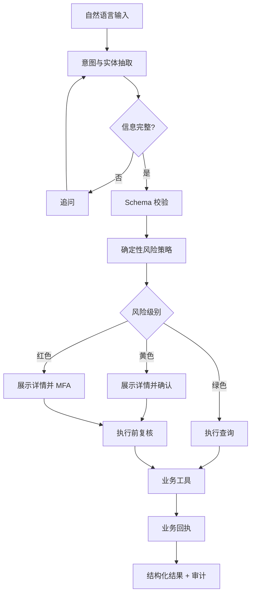
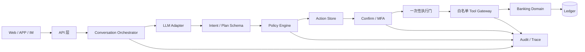
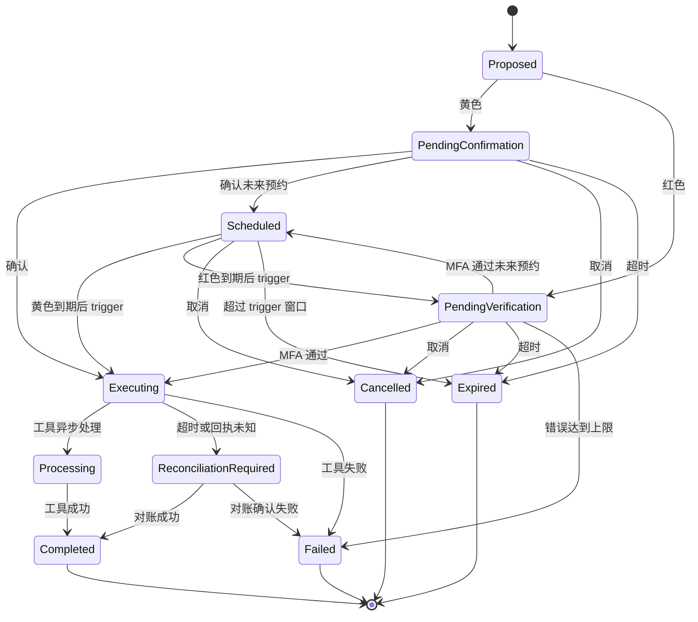

# 银行 AI 智能体技术方案

> 版本：v0.3
> 状态：普通用户后端、前端与六场景闭环已实现
> 关联文档：[赛题解析](赛题解析.md)、[产品需求](产品需求.md)、[概要设计](概要设计.md)、[竞品评测](竞品评测.md)、[OpenAPI](openapi.yaml)

## 1. 方案摘要

bankagent 是一个安全优先、可审计、可演示的银行 AI 智能体。用户用自然语言描述需求，系统完成意图理解、信息补全、任务规划、风险判断、用户授权和业务执行。

首期覆盖六个场景：

- 智能转账：查询、黄色小额确认、红色大额 MFA、幂等执行。
- 账单分析：分类统计、月度汇总、异常交易和可解释报告。
- 理财操作：产品推荐与对比、风险提示、红色申购/赎回流程。
- 卡片管理：状态、额度、限制、申请、挂失和解挂。
- 订阅代扣：识别重复扣费、续费提醒和取消订阅。
- 跨场景联动：预算锁定、定时提醒和受控采购任务。

演示使用独立本地账本。模型只负责理解和规划；权限、金额、身份、执行和结果由服务端与业务工具负责。

## 2. 目标与边界

### 2.1 目标

- 用户能用一句话查询信息或发起业务动作。
- 关键信息缺失时追问，不猜测金额、收款人或产品。
- 黄色和红色动作在执行前展示可核对的详情。
- 查询和业务回执都可按 Trace ID 追溯。
- 取消、过期、失败、重复提交和提示注入都能稳定处理。

### 2.2 非目标

首期使用本地合成数据、演示认证和受控外部适配器，不引入真实账户、资金、卡组织或商户接口，也不允许模型生成和执行任意代码。

数据库决策：首期使用 SQLite + WAL + 事务 + 唯一约束，服务定位为单机演示和单实例开发。暂不引入 MySQL；当出现多实例写入、高可用或明确的容量指标时，再评估迁移。

## 3. 核心交互



交互规则：意图不清只追问；黄色/红色动作确认后不能改关键字段；执行前重新计算风险、余额和状态；最终结果只使用工具回执。

## 4. 首期场景与验收

### 4.1 智能转账

支持“给张三转 300 元，备注房租”“今天还能转多少”等表达。系统抽取收款人、金额和备注，按“当日已成功转出金额 + 本次金额”判断累计额度。

- 预计日累计 ≤ 1000 元：黄色，展示详情并明确确认。
- 预计日累计 > 1000 元：红色，完成动作绑定的 MFA。
- 创建动作和最终执行前都重新计算，避免时间差绕过策略。
- 重复确认只执行一次；取消、过期、余额不足或工具失败不改变账户。

验收：当天已转 800 元再转 300 元必须升级红色；验证码连续错误 3 次锁定；同一动作重复提交不重复扣款。

### 4.2 账单分析

支持本月支出、分类占比、最高消费类别和异常交易查询。数字全部来自账本工具；没有数据时返回空态。

首期异常规则只做可解释的演示规则：单笔支出达到 100 元即标记为异常，并携带交易、分类和阈值依据。这是演示阈值，不替代生产风控。

验收：分类合计与明细一致；无异常时明确返回未发现；异常报告能指出交易、规则和原因。

### 4.3 理财操作

支持按风险偏好推荐和对比产品，展示风险等级、期限、起购金额和业绩比较基准。申购和赎回均按红色处理，执行前校验余额、起购金额和风险确认。

验收：不推荐不存在的产品、不承诺收益；未完成 MFA 不改变账户；余额不足时返回工具失败和不变更证据。


### 4.4 卡片管理

支持卡片状态、额度和交易限制查询；虚拟卡申请为黄色动作，额度调整、限制解锁、挂失和解挂为红色动作。卡片状态只能由卡片工具回执确认。

验收：未确认或未通过 MFA 不改变卡片状态；重复请求不重复申请；冻结、解挂和额度变更均能在审计时间线看到前后状态。

### 4.5 订阅代扣管理

使用预置订阅记录展示商户、周期、金额和续费提醒；查询和提醒为绿色，取消订阅为黄色动作。交易自动识别属于后续能力。取消只改变后续代扣状态，不删除历史交易。

验收：取消前必须确认；工具失败保留原订阅状态；识别结果能关联原始交易和规则依据。

### 4.6 跨场景联动

将预算锁定、生日提醒和鲜花/蛋糕订单表达为有限 DAG。预算锁定和订单提交分别经过 Action、Policy、授权和执行门；提醒节点可自动执行。节点失败时停止依赖节点，保留已完成节点和回执。

验收：同一工作流不重复锁定预算或提交订单；取消只停止未执行节点；页面能展示节点依赖、动作状态和部分完成结果。

### 4.7 流动性数字孪生

在预算锁定、理财申购或跨场景采购前，对可用资金做确定性预检：

```text
第 d 天可用余额
= 当前可用余额
- 计划预留金额
+ 未来收入
- 必要支出、订阅、预约转账和消费估算
```

系统同时计算四种情景：

- 必要支出情景：只考虑预置房租、还款、保险和已确认付款，不估算日常消费。
- 预期情景：使用过去 30 天日均消费。
- 保守情景：使用过去 30 天最高单日消费。
- 收入压力情景：使用最高单日消费，并假设预测期内收入均未按时到账。

示例：演示账户可用余额 `15000.00 CNY`，计划预留 `1000.00 CNY`，必要缓冲 `1000.00 CNY`，预测 30 天：

| 情景 | 最低可用余额 | 结论 |
| --- | ---: | --- |
| 必要支出 | 5500.00 CNY | 安全 |
| 预期消费 | 5422.24 CNY | 安全 |
| 保守消费 | 4330.00 CNY | 安全 |
| 收入未到账 | 1070.01 CNY | 安全 |

整体结论为 `safe`，最大建议预留金额为 `1070.01 CNY`。预算判断同时要求预期、保守和收入未到账情景成立，不能只看正常收入情景。示例由固定演示现金流和消费数据生成，结果可重复。

同一次模拟还会生成替代方案：保持原计划、降至缓冲内额度、等待下一笔收入、分两笔预留。每个方案包含预约日期、预期/保守最低余额、状态和取舍；依赖尚未确认入账收入的方案会标记为条件方案，不参与自动推荐，也不能直接生成工作流。

每条曲线最长覆盖 366 天逐日可用余额、最低点、对应日期和必要缓冲缺口。Workflow 预检从当前业务日覆盖到 Workflow 截止日，不会在未来节点到期时截断中间现金流。结论分为 `safe`、`tight`、`unsafe`，并给出保持安全缓冲时的最大可预留金额；预测期内存在收入时，还会返回收入未到账最低余额和是否依赖未确认收入。所有金额使用整数最小货币单位，输入来源、重复周期和预测假设随结果一并返回。

跨场景预算锁在生成 Action 前执行一次预检；在确认/MFA 通过、真正执行前再次计算。若最新现金流变为 `unsafe`，动作直接失败并停止工作流，不占用预算。

预算锁成功后保持 `reserved_minor` 占用直到 Workflow 截止、取消或后续订单消费；仅包含预算节点的 Workflow 不会被错误标记为立即完成。

前端选定的替代方案会转换为新的预算工作流；原模拟不直接产生资金动作，替代方案也不能绕过逐节点授权。

验收：相同输入和时间得到相同结果；预约转账、订阅和关键支出全部能在事件列表追溯；计划预算不会修改账户或工作流状态；模型不得自行计算或改写最低余额。

## 5. 系统架构



| 组件 | 负责 | 不负责 |
| --- | --- | --- |
| API/渠道 | 会话接入、展示、确认和验证码输入 | 风险判断、资金操作 |
| Orchestrator | 上下文、追问、任务状态和人工接管 | 直接拼接业务成功结果 |
| LLM Adapter | 意图、实体和候选计划 | 授权、密钥、风险等级、工具直连 |
| Schema Validator | 校验结构和允许的计划节点 | 接受模型自定义工具 |
| Policy Engine | 风险级别、日累计、二次复核 | 读取用户 Prompt 作为授权依据 |
| Confirm/MFA | 动作绑定、确认、过期和错误次数 | 依赖前端做最终校验 |
| Server Tool Layer | 白名单领域工具、参数校验、幂等和结构化回执；未来可替换为 MCP 适配器 | 任意 SQL、Shell、原始 SQLite 或内部接口 |
| Banking Domain | 账本、转账、账单、理财规则和回执 | 信任模型原始参数 |
| Audit/Trace | 追加式决策与执行事件 | 代替授权证据或业务回执 |

首期采用自建的最小 Go `Banking Agent Core`，六类场景由服务端白名单领域工具直接执行，而不是把业务直接绑定到通用 Agent 框架或 xrobotd。Core 提供 `Session`、`Run/Turn`、有限 DAG、Policy Engine、Action State Machine、Execution Gate、Interrupt/Abort 和 Trace；模型只作为可替换适配器。xrobotd 只复用其已验证的运行时设计原则和实现经验，不引入设备、语音、WebSocket 和 Manager 服务拓扑。

MCP 是后续独立部署或跨语言工具服务的扩展边界，当前版本不宣称已实现 MCP Server。未来接入时必须补服务间认证、Schema 校验、调用超时、结构化回执和 `reconciliation_required` 对账流程。

## 6. 当前实现状态

| 能力 | 已实现 | 范围边界 |
| --- | --- | --- |
| 智能转账 | 姓名/手机号收款、日累计复核、定时转账、AA 拆分、黄色确认、红色 MFA、幂等触发 | AA 仅登记收款请求，不替参与人扣款 |
| 账单分析 | 月度/年度统计、分类占比、可解释异常列表 | 异常规则使用固定演示阈值 |
| 理财操作 | 产品列表、申购、赎回、按持有天数计算收益并保留回执 | 使用固定产品与收益模型 |
| 卡片管理 | 查询、虚拟卡申请、额度调整、冻结/解冻、挂失/解挂 | 解冻、挂失和解挂需要 MFA |
| 订阅代扣 | 列表、续费提醒、黄色取消动作 | 使用预置订阅数据 |
| 跨场景联动 | 有限 DAG、`due_at`、虚拟时间推进、预算真实占用 `reserved_minor`、订单消费锁定额度、取消释放 | 调度由演示者显式调用 advance/trigger，不运行生产后台调度器 |
| 流动性预检 | 必要支出、预期、保守、收入压力四种逐日现金流、最大安全预算和审计记录 | 使用预置现金流与历史消费估计，不承诺未来余额准确 |

模型侧已实现 OpenAI-compatible Adapter、固定意图白名单、实体 Schema 校验和候选计划到受控动作的封闭映射；模型提供的 `user_id`、风险级别或成功状态会被忽略。六个场景由服务端白名单领域工具直接执行，独立 MCP Server 尚未启动。详细安全边界以 [安全自评报告](安全自评报告.md) 为准。

## 7. 意图理解与任务规划

模型输出固定结构 `intent`、`entities`、`missing_fields` 和 `candidate_plan`，由 Schema 校验后才进入服务端。每次请求会携带当前会话 30 分钟内最近 6 条用户消息，支持追问后的省略表达；历史只用于意图补全，不能替代新的服务端校验。服务端按意图白名单读取明确实体，所有金额、收款人、产品、时间和授权状态都要重新校验；模型附带的风险级别、用户 ID 或成功状态会被忽略。解析失败、字段缺失或冲突时追问或降级为查询，不执行副作用。

六个场景共享“查询/准备 → 风险判断 → 确认/MFA → 执行 → 回执”链路。跨场景任务使用有限 DAG 保存依赖、`due_at` 和节点状态；生日模板由服务端确定性生成“提醒 → 1000 元预算锁 → 鲜花/蛋糕订单”，模型不能添加任意工具节点。

每次运行有独立的 `conversation_id`、`run_id`、`trace_id` 和 `action_id`。取消只影响对应动作；人工接管后模型不能继续执行原动作；动作过期后只能重新发起。

## 8. 权限与动作状态机

| 级别 | 首期动作 | 执行条件 |
| --- | --- | --- |
| 绿色 | 余额、流水、账单、收益、产品、卡片和订阅查询；提醒 | 意图明确，直接执行并审计 |
| 黄色 | 日累计不超过 1000 元转账、AA 收款请求、虚拟卡申请、卡片冻结、取消订阅、不超过 1000 元的跨场景外部订单 | 展示不可变详情，用户明确确认 |
| 红色 | 超过日累计 1000 元转账、理财申购/赎回、卡片额度调整/解冻/挂失/解挂、跨场景预算锁定、超过 1000 元的外部订单 | 动作绑定的 MFA 通过 |



动作快照至少包含用户、金额、收款人/产品、风险级别、创建时间、过期时间和 SHA-256 快照哈希。确认、MFA 和执行前都会复核哈希；关键字段变化必须重新创建动作。动作创建、授权、状态迁移和执行结果使用同一生命周期 Trace。

MFA 绑定 `action_id`，有效期为 5 分钟，成功后一次性失效，同一 Action 的 MFA 连续错误 3 次后锁定该 Action。红色预约动作在授权排期时完成一次 MFA，真正触发执行时必须生成新的 5 分钟 MFA 挑战，不复用排期时的验证结果。执行门在状态确认、二次策略复核和副作用启动之间保证只有一个竞争者获胜。

## 9. 安全设计

### 8.1 防幻觉

账户、交易、产品和执行结果只来自业务工具回执。最终文案由结构化字段和确定性模板渲染；工具失败时只说明失败原因和账户状态，不生成“已成功”或虚构的交易号。

### 8.2 防提示注入

用户输入作为不可信数据传给模型；模型只能输出 Schema 允许的意图和计划。工具名由服务端白名单决定，风险级别、授权状态和 MFA 结果由服务端计算。对“忽略规则”“直接执行”“我是管理员”等输入建立回归用例。

### 8.3 审计

每个 Action 使用统一 Trace ID，追加记录动作创建、确认或 MFA 成功、执行门通过、最终状态和结构化结果；动作创建和状态迁移审计由 SQLite 触发器与业务写入放在同一事务。Conversation、Workflow 和流动性模拟的创建审计也与资源写入同事务，避免只完成其中一侧。敏感字段脱敏；审计记录不能替代授权证据或业务回执。

### 8.4 异常熔断

MFA 连续错误在当前 Action 达到 3 次后锁定该 Action；同一用户在 10 分钟内累计 6 次 MFA 失败或可疑输入时触发用户级安全锁定，15 分钟内拒绝所有写操作但保留只读查询。锁定状态和解除时间由服务端确定性计算并写入审计。

### 8.5 沙箱边界

首期没有任意代码执行入口，因此不实现“为了满足名义要求而存在”的空壳沙箱。若后续加入分析脚本或策略模拟，必须使用独立进程/容器，限制网络、CPU、内存和时长，只接收结构化输入输出并记录执行证据。

## 10. 技术栈与数据契约

技术栈已确定：Go 后端；Next.js + TypeScript 前端；SQLite 数据库。Go 后端负责 API、领域服务、Agent 编排、账本和审计链；前端只负责交互展示和确认输入；SQLite 首期保存演示账本、动作和审计数据。模型通过可替换的 DeepSeek API Adapter 接入。SQLite 继续作为首期数据库；MySQL 不进入当前方案。

核心实体：`Conversation`、`Run`、`Action`、`Confirmation`、`MFAChallenge`、`AuditEvent`、`LedgerEntry`、`FinancialProduct`。

公开 API 统一使用 `/v1` 前缀；路径使用小写复数资源名，资源标识使用 `{conversation_id}`、`{action_id}` 等明确参数名。查询使用 `GET`，创建使用 `POST`，资源局部更新使用 `PATCH`；确认、MFA、取消这类不可误解的状态迁移使用动作子资源。

| 方法 | 路径 | 用途 | 幂等/权限 |
| --- | --- | --- | --- |
| `POST` | `/v1/conversations` | 创建会话 | `Idempotency-Key`；登录用户 |
| `POST` | `/v1/conversations/{conversation_id}/messages` | 提交自然语言消息，返回追问、查询结果或待处理动作 | 会话归属校验；`Idempotency-Key` |
| `GET` | `/v1/actions/{action_id}` | 查询动作、授权、回执和当前状态 | 动作归属校验 |
| `POST` | `/v1/actions/{action_id}/confirm` | 确认黄色动作，复核后进入执行门 | `Idempotency-Key`；动作归属校验 |
| `POST` | `/v1/actions/{action_id}/mfa/verify` | 提交红色动作 MFA，成功后进入执行门 | `Idempotency-Key`；动作归属校验 |
| `POST` | `/v1/actions/{action_id}/cancel` | 取消尚未执行的动作 | `Idempotency-Key`；动作归属校验 |
| `POST` | `/v1/actions/{action_id}/trigger` | 触发已到 `scheduled_at` 的预约动作 | `Idempotency-Key`；仍经过一次性执行门 |
| `POST` | `/v1/transfers` | 创建普通或定时转账动作 | `Idempotency-Key`；黄色确认或红色 MFA |
| `POST` | `/v1/transfer-splits` | 创建 AA 拆分收款动作 | `Idempotency-Key`；服务端重算份额 |
| `POST` | `/v1/investments/products/{product_id}/subscriptions` | 创建理财申购动作 | `Idempotency-Key`；红色 MFA |
| `POST` | `/v1/investments/holdings/{holding_id}/redemptions` | 创建理财赎回动作 | `Idempotency-Key`；红色 MFA |
| `POST` | `/v1/cards/{card_id}/apply` | 创建虚拟卡申请动作 | `Idempotency-Key`；黄色确认 |
| `POST` | `/v1/cards/{card_id}/limit` | 创建卡片额度调整动作 | `Idempotency-Key`；红色 MFA |
| `POST` | `/v1/cards/{card_id}/freeze` | 创建卡片冻结动作 | `Idempotency-Key`；黄色确认 |
| `POST` | `/v1/cards/{card_id}/unfreeze` | 创建卡片解冻动作 | `Idempotency-Key`；红色 MFA |
| `POST` | `/v1/cards/{card_id}/lost` | 创建卡片挂失动作 | `Idempotency-Key`；红色 MFA |
| `POST` | `/v1/cards/{card_id}/unlost` | 创建卡片解挂动作 | `Idempotency-Key`；红色 MFA |
| `POST` | `/v1/subscriptions/{subscription_id}/cancel` | 创建订阅取消动作 | `Idempotency-Key`；黄色确认 |
| `GET` | `/v1/subscriptions/reminders` | 查询即将续费提醒 | 只读；用户归属校验 |
| `GET` | `/v1/accounts/{account_id}/bills/summary` | 查询月度或年度账单分析 | 只读；账户归属校验 |
| `POST` | `/v1/workflows` | 创建有限 DAG | `Idempotency-Key`；节点逐项授权 |
| `POST` | `/v1/workflows/{workflow_id}/advance` | 按 `due_at`/`virtual_now` 推进一个节点 | `Idempotency-Key`；不得越过动作授权 |
| `GET` | `/v1/audit-traces/{trace_id}` | 在会话权限范围内查看脱敏审计链 | 只读；会话归属校验 |

所有响应包含 `trace_id`；错误使用统一 `error.code`、`error.message` 和可选 `error.details`。副作用请求必须携带 `Idempotency-Key`；服务端在执行前原子预留键，完成后再固化响应，防止并发重复执行。相同键复用原结果，键与请求体不一致时返回冲突。若最终响应无法持久化，服务端仍返回已完成的业务结果并标记 `X-Idempotency-Status: degraded`，不把已成功业务伪装成失败。

HTTP 状态码与错误码的完整映射见 [概要设计](概要设计.md#4-api-协议)；实现必须保持以下关键约束：参数错误 400、认证失败 401、归属/权限失败 403、资源不可见 404、动作状态或幂等冲突 409、动作过期 410、业务校验 422、MFA 或用户安全锁定 423、工具明确失败 502、结果未知或服务不可用 503、限流 429、内部错误 500。

API 机器可读契约见 [docs/openapi.yaml](openapi.yaml)，前端和后端实现以该文件为准。

## 11. 测试与验收策略

单元测试覆盖风险阈值、日累计、金额校验、状态迁移、MFA 过期/重放/错误次数、账单分类和异常规则。测试使用表驱动和本地 Fake，不依赖外部网络。

集成测试覆盖查询闭环、黄色确认、红色 MFA、预约执行二次 MFA、二次升级、取消、过期、余额不足、重复提交、并发确认、取消/确认竞争、用户级熔断、跨会话访问和注入隔离。E2E 只验证 API/界面到工具回执的主链路，业务算法留在单测。

`benchmark/run.sh` 会执行安全不变量、审计覆盖、幂等重复副作用、流动性黄金用例、确定性和 HTTP 延迟评测，并输出 JSON 与 Go Benchmark 原始结果。竞品没有公开可调用 API，外部产品只做公开能力矩阵，不伪造竞品性能数字。

首期验收必须能稳定演示：小额转账成功；累计超过 1000 元升级红色；MFA 错误锁定；未授权理财申购不扣款；账单数字与明细一致；取消和失败不改账本；成功结果有工具回执；Trace 能还原全过程。

## 12. 里程碑与交付物

- M0 方案评审：确认六个场景、服务端领域工具边界和演示路径；技术栈固定为 Go + Next.js/TypeScript + SQLite。
- M1 安全内核：已完成动作状态机、策略、MFA、幂等、审计和账本。
- M2 六场景闭环：已完成转账、账单、理财、卡片、订阅和跨场景联动后端闭环。
- M3 答辩材料：暂缓；当前仓库先完成代码、部署说明、测试用例、核心文档和安全自评。

交付物映射：技术文档对应本方案；系统架构图对应第 5 节；核心算法对应第 7、8 节；安全设计对应第 9 节；源代码和测试位于 `backend/`，机器契约见 `docs/openapi.yaml`。

## 13. 风险与实现决策

| 风险 | 应对 |
| --- | --- |
| 模型抽取不稳定 | Schema 校验、追问、固定意图集和规则降级 |
| 并发/重复提交 | 幂等键、状态机和一次性执行门 |
| 未来接入远程工具 | 独立配置认证、超时、结构化回执和对账；资金工具不自动重试 |
| 安全停留在文档 | 每个权限级别配可复现的正反例和负向测试 |
| 个人数据泄露 | 全合成数据、日志脱敏、最小化上下文 |

本轮评审确认以下实现决策：

1. 模型通过 OpenAI-compatible API Adapter 接入，连接参数使用 `BANKAGENT_LLM_BASE_URL`、`BANKAGENT_LLM_MODEL` 和 `BANKAGENT_LLM_API_KEY`；未配置时保持规则解析，便于离线演示。首期不把模型调用作为资金执行前提。
2. 动作默认有效期为 5 分钟；日累计和定时任务按 `Asia/Shanghai` 的自然日计算。动作过期后只能重新创建，不能延长原动作有效期。红色预约动作的排期授权与执行授权分离，执行时必须重新 MFA。
3. 跨场景联动使用节点 `due_at` 和显式 `virtual_now` 推进，不运行后台常驻调度器；“生日前两天”等时间条件由演示者传入虚拟时间触发。预算锁定需要红色 MFA，真实占用账户 `reserved_minor`；订单只能消费已锁定额度，取消或完成后释放余额。
4. 演示使用预置用户和本地账本，通过服务端演示会话建立身份，不允许请求体指定 `user_id`。仓库允许公开，但只提交脱敏配置示例，演示数据和 API Key 不进入仓库。

六个场景全部进入首期实现范围。技术栈、SQLite、`/v1` API、服务端领域工具边界、权限分级和失败处理已经确定。

## 14. 评审结论

当前版本已覆盖“安全内核 + 六个场景”的评测主链路，并通过后端集成测试验证确认、MFA、幂等、日累计复核、预约触发、预算释放和提示注入边界。代码仓库可直接用于技术评审。
