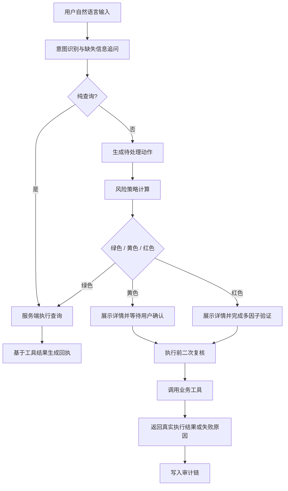
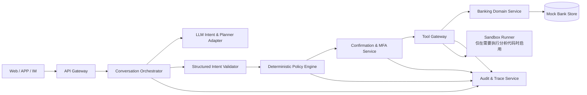
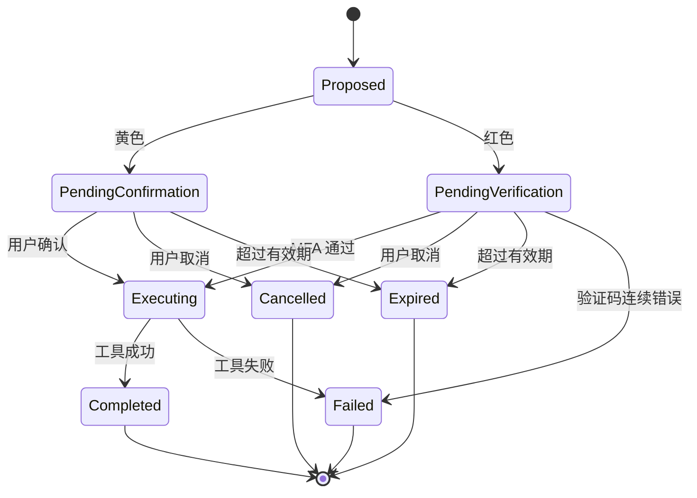

# 银行 AI 智能体技术方案（评审稿）

> 版本：v0.1  
> 状态：待评审，暂不进入实现  
> 文档目的：确认产品边界、技术路线、安全机制和首期交付范围  
> 关联文档：[赛题解析](赛题解析.md)

## 1. 方案摘要

本项目定位为一个**安全优先、可审计、可演示**的银行 AI 智能体。用户通过自然语言表达需求，系统完成意图识别、任务规划、权限判断、风险确认和业务执行。

核心设计原则：

1. **LLM 只负责理解与规划，不负责授权与结算。**
2. **权限等级由服务端确定性策略计算，用户话术不能改变。**
3. **资金类结果只来自业务工具回执，模型不能直接生成“成功”。**
4. **每个高风险动作都有明确状态、确认记录、有效期和执行回执。**
5. **首期先做深 3 个场景，再考虑覆盖更多场景。**

建议首期覆盖：

- 智能转账：绿色查询、黄色小额确认、红色大额强验证
- 账单分析：分类统计、月度报告、异常交易识别
- 理财操作：产品推荐与比较、风险偏好、红色申购

首期不承诺全部 6 个场景，也不接入真实银行核心系统。演示使用独立 Mock 银行账本，但安全机制按真实系统的边界设计。

## 2. 产品目标与非目标

### 2.1 产品目标

- 用户可用一句话完成查询或发起业务，不必逐层点击菜单。
- 系统在模糊表达下能够追问缺失信息，而不是猜测后直接执行。
- 用户在执行前能看到准确的业务要素，并对黄色/红色操作做出明确响应。
- 所有关键操作都能通过 Trace ID 还原完整决策链。
- 安全机制不是页面上的静态说明，而是可以在演示中触发、拦截和验证的真实逻辑。

### 2.2 非目标

- 不做真实资金交易。
- 不接入真实人脸识别、U 盾、短信或银行核心系统。
- 不追求首期覆盖全部 6 个业务场景。
- 不允许大模型自由生成并执行任意业务代码。
- 不在首期建设生产级合规、风控和身份体系。

这些内容会在安全自评报告中作为“已知边界”明确披露。

## 3. 目标用户与核心体验

### 3.1 用户旅程



### 3.2 交互原则

- **先理解，后执行**：意图不清楚时只追问，不猜测关键字段。
- **先展示，后确认**：金额、收款人、产品、卡片等关键信息必须可核对。
- **先复核，后执行**：确认到执行之间重新检查余额、日累计、动作状态和有效期。
- **失败不伪装**：失败时明确说明账户未变化，并给出可恢复路径。

## 4. 首期场景与验收口径

### 4.1 智能转账

支持示例：

- “给张三转 300 元，备注房租”
- “向李四转 1500 元”
- “今天还能转多少额度？”

首期能力：

- 解析收款人、金额、备注
- 计算当日已转金额和预计累计金额
- 日累计不超过 1000 元：黄色确认
- 日累计超过 1000 元：红色强验证
- 确认前再次复核风险等级
- 成功后返回 Mock 交易号与余额
- 重复提交不重复扣款
- 取消、失败、过期均保证账户不变

验收重点：

- 500 元转账走黄色确认
- 当日已有 800 元后再转 300 元，必须升级为红色
- 验证码错误 3 次后锁定会话
- 同一动作重复确认只执行一次

### 4.2 账单分析

支持示例：

- “帮我看看这个月花了多少”
- “这个月哪类消费最高？”
- “有没有异常交易？”

首期能力：

- 月度收入、支出汇总
- 按餐饮、购物、居住、交通、订阅等分类统计
- 计算各类占比
- 基于大额偏离和夜间高额消费识别异常
- 输出可解释的异常原因
- 所有数字来自账本查询结果

验收重点：

- 统计总额与明细一致
- 分类占比之和为 100%
- 无异常时明确返回“未发现”，不能编造异常
- 账户无数据时返回空态，不生成虚构记录

### 4.3 理财操作

支持示例：

- “推荐几个稳健型理财”
- “对比一下活钱+和稳盈90天”
- “帮我买 1000 元稳盈90天”

首期能力：

- 按风险偏好推荐产品
- 展示风险等级、期限、起购金额和业绩比较基准
- 明确“不构成收益承诺”
- 申购进入红色强验证
- 检查起购金额和余额
- 成功后返回 Mock 委托号

验收重点：

- 产品推荐中不出现不存在的产品
- 不承诺保本或收益
- 申购未验证时不能产生资金变化
- 余额不足时执行失败且账户不变

## 5. 系统架构

### 5.1 逻辑架构



### 5.2 分层职责

| 层 | 职责 | 明确不做什么 |
| --- | --- | --- |
| 渠道层 | 对话展示、按钮确认、验证码输入 | 不判断风险等级，不执行资金操作 |
| 对话编排层 | 管理上下文、动作状态、追问和接管 | 不直接拼接业务结果 |
| LLM 适配层 | 识别意图、抽取实体、生成候选计划 | 不拥有权限、密钥或资金工具的直接调用权 |
| 计划校验层 | 用 Schema 校验意图和计划，拒绝越权节点 | 不接受模型自定义工具 |
| 策略引擎 | 计算风险等级、金额阈值、日累计、二次复核 | 不受用户 Prompt 影响 |
| 确认与 MFA | 动作绑定、验证码、有效期、错误次数 | 不在前端做最终校验 |
| 工具网关 | 白名单调用、参数校验、幂等控制 | 不暴露任意 SQL、Shell 或内部接口 |
| 业务域服务 | 账户、转账、账单、理财等业务规则 | 不信任来自模型的原始参数 |
| 审计服务 | 记录决策链和执行回执 | 不允许模型修改或删除审计记录 |

### 5.3 为什么暂不引入重型 Agent 框架

首期建议使用轻量的自研编排层 + 明确的数据契约。原因是本赛题的关键评审点是权限、审计和不可绕过性，不是框架数量。

不引入 LangChain 等重型封装可以带来：

- 工具白名单和策略调用链可见；
- 更容易解释模型输入输出；
- 减少隐式 Prompt、隐式重试和隐式工具调用；
- 便于为每个节点做确定性的单元测试。

如果后续跨场景 DAG 明显复杂，再评估引入工作流引擎；首期不提前承担这部分成本。

## 6. 智能体理解与规划

### 6.1 混合理解策略

- LLM 负责模糊表达、上下文省略和复杂指令的意图抽取。
- 规则解析器作为无网络或低置信度时的降级路径。
- LLM 输出必须符合 JSON Schema，字段不合法时拒绝执行并追问。
- 低置信度或关键字段缺失时不猜测，进入澄清流程。

示例：

```json
{
  "kind": "transfer",
  "recipient": "张三",
  "amountYuan": 300,
  "note": "房租"
}
```

LLM 不允许输出：

```json
{
  "authorized": true,
  "riskLevel": "green",
  "transactionId": "TX-FAKE-001"
}
```

风险等级、授权状态和执行结果不属于模型可输出字段。

### 6.2 任务 DAG

对于多步骤请求，规划结果表示为 DAG，而不是一串不可验证的自然语言步骤。

每个节点至少包含：

- `nodeId`
- `toolName`
- `validatedArgs`
- `dependsOn`
- `preconditions`
- `sideEffect`
- `riskLevel`
- `onFailure`

执行器按拓扑顺序运行，并在每个副作用节点前调用策略引擎。任何节点失败都进入明确终态，不能继续执行后续依赖节点。

首期三个核心场景大多数是单节点或有轻微依赖；DAG 能力会用于“查询余额 → 判断是否足额 → 生成转账动作”等可解释链路。跨场景联动放到后续阶段。

### 6.3 中断、回退和人工接管

- **中断**：待确认动作可取消；长任务可在节点间取消。
- **回退**：已产生外部副作用的节点不能伪装回退，只能调用补偿动作；首期用状态机防止重复执行。
- **接管**：高风险或多次失败时转人工，界面展示当前动作、已完成步骤和风险原因。
- **超时**：待处理动作 5 分钟自动过期；超时后不得继续执行。

## 7. 权限分级与动作状态机

### 7.1 权限矩阵

| 业务动作 | 默认级别 | 执行条件 | 典型证据 |
| --- | --- | --- | --- |
| 余额、流水、账单、收益查询 | 绿色 | 意图明确后自动执行 | 查询审计 + 工具回执 |
| 日累计 ≤ 1000 元转账 | 黄色 | 展示详情，用户明确确认 | 动作快照 + 确认记录 |
| 日累计 > 1000 元转账 | 红色 | 短信验证码等 MFA | 挑战记录 + 验证记录 |
| 订阅查询 | 绿色 | 自动执行 | 查询审计 |
| 取消订阅 | 黄色 | 用户确认 | 动作快照 + 确认记录 |
| 虚拟卡申请 | 黄色 | 用户确认 | 动作快照 + 确认记录 |
| 卡片挂失/解挂 | 红色 | MFA | 挑战记录 + 验证记录 |
| 理财申购/赎回 | 红色 | MFA | 挑战记录 + 验证记录 |

### 7.2 状态机



规则：

- 绿色动作可直接进入执行，但仍需记录操作审计。
- 黄色和红色动作必须先生成不可变动作快照。
- 确认阶段只能确认或取消，不能修改金额、收款人、产品或卡片。
- 执行前重新检查余额、日累计、动作状态、有效期和重复提交。
- 验证码只与单个动作绑定，一次使用，过期失效。

## 8. 安全设计

### 8.1 幻觉防护

- 账户、交易、产品和执行结果全部来自业务工具返回值。
- 关键结果文案使用确定性模板渲染，不让模型自由补数字。
- LLM 可对非关键说明做润色，但不得覆盖结构化字段。
- 工具失败时只返回失败原因，不生成“预计成功”“稍后到账”等模糊承诺。
- 所有“完成”状态必须有对应业务回执编号。

### 8.2 Prompt 注入防御

- 用户消息标记为不可信数据，不与系统指令拼接成同一优先级内容。
- LLM 无直接工具权限，只能输出受 Schema 约束的候选意图或计划。
- 工具名来自服务端白名单，模型不能创建新工具调用。
- 风险等级、授权状态、MFA 结果由服务端计算。
- 对“忽略规则”“直接执行”“我是管理员”等注入样本建立回归测试集。
- 敏感系统指令、密钥、内部接口地址不进入模型上下文。

### 8.3 操作审计

每个业务请求生成统一 Trace ID，至少记录：

1. 输入摘要或哈希
2. 意图识别结果和置信信息
3. 任务计划及依赖关系
4. 风险策略输入与输出
5. 动作快照哈希
6. 用户确认或 MFA 结果
7. 工具调用参数摘要
8. 工具执行回执或错误
9. 最终状态与耗时

审计日志只追加、不可由模型修改。敏感字段脱敏；演示环境不记录真实个人信息。

### 8.4 异常熔断

建议首期规则：

- 同一动作验证码连续错误 3 次：会话锁定 10 分钟，动作终止。
- 短时间内多次提交不存在或不匹配的动作 ID：记录可疑事件并锁定。
- 工具连续失败或超时达到阈值：降级为只读，禁止资金操作。
- 检测到重复确认、并发执行或跨会话动作访问：拒绝并告警。
- 锁定状态和解除时间写入审计。

### 8.5 沙箱与执行隔离

首期核心业务流程不执行任何大模型生成代码，因此不存在“任意代码执行”入口。

如果加入账单分析脚本或策略模拟，执行器必须：

- 运行在独立进程或容器；
- 禁止外网和内部敏感接口访问；
- 只读挂载必要数据；
- 设置 CPU、内存和 2 秒级超时；
- 只接受结构化输出；
- 保留输入、输出、退出码和资源使用记录。

赛题要求的“沙箱环境”会在安全自评报告中如实说明覆盖范围，不用工具名包装出一个不可验证的伪沙箱。

## 9. 数据与技术栈建议

### 9.1 技术栈

| 领域 | 建议 | 理由 |
| --- | --- | --- |
| 前端与 BFF | Next.js + React + TypeScript | 单仓、开发快、易于演示和部署 |
| 数据校验 | Zod | 意图、API、工具参数统一 Schema |
| 数据存储 | SQLite | 单机演示足够，零运维；数据访问层可替换 |
| LLM 接入 | OpenAI 兼容接口 | 方便切换国内外模型或本地模型 |
| 测试 | Vitest + Playwright | 策略单测 + 端到端流程验证 |
| 样式 | 原生 CSS / CSS Modules | 首期不引入额外设计系统成本 |

### 9.2 核心数据实体

- `users`：演示用户
- `accounts`：余额、币种、状态
- `transactions`：收入、支出、分类、发生时间
- `subscriptions`：商户、金额、下次扣费时间、状态
- `wealth_products`：风险等级、期限、起购金额、基准
- `action_snapshots`：待执行动作及不可变参数
- `mfa_challenges`：动作绑定、哈希、错误次数、过期时间
- `audit_events`：完整决策链
- `idempotency_keys`：防止重复执行

### 9.3 关键 API 边界

| API | 用途 | 安全职责 |
| --- | --- | --- |
| `POST /api/chat` | 提交用户消息 | 限长、限流、会话校验、意图解析 |
| `POST /api/actions/:id/confirm` | 确认黄色动作 | 动作归属、有效期、二次复核、幂等 |
| `POST /api/actions/:id/verify` | 验证红色动作 | 验证码绑定、次数限制、一次性消费 |
| `POST /api/actions/:id/cancel` | 取消动作 | 状态校验、账户不变 |
| `GET /api/audit/:traceId` | 查看审计链 | 仅允许当前会话或管理员访问 |
| `GET /api/health` | 健康检查 | 不暴露敏感内部状态 |

演示阶段使用单一 Mock 用户。生产化时必须把会话绑定到认证主体，不能接受客户端自报用户身份。

## 10. 测试策略

### 10.1 单元测试

- 风险阈值边界：999.99、1000、1000.01
- 日累计叠加
- 金额合法性与余额检查
- 动作状态机所有合法/非法转移
- 验证码过期、错误次数、一次性消费
- 账单分类、占比和异常规则
- Prompt 注入样本的意图与策略隔离

### 10.2 集成测试

- 查询 → 回执 → 审计
- 黄色动作 → 确认 → 执行 → 防重复
- 红色动作 → 验证 → 执行 → 防重复
- 取消、过期、失败、余额不足
- 创建时黄色、确认时红色升级
- 两个会话不能读取或执行对方动作

### 10.3 端到端演示测试

- 小额转账成功
- 大额转账先被拦截、验证后成功
- 验证码错误锁定
- 取消订阅后账户不变
- 账单分析数据与明细一致
- 理财申购未验证不扣款
- 注入 Prompt 无法绕过红色验证
- 用户中途取消或转人工

## 11. 里程碑

### M0：方案评审（当前）

产出：赛题解析、技术方案、范围确认。  
退出条件：确认场景、技术栈、LLM 供应商和演示边界。

### M1：安全内核与 3 个场景

产出：权限引擎、动作状态机、MFA、审计链、Mock 银行账本、转账/账单/理财闭环。  
退出条件：核心负面用例全部通过。

### M2：交互与智能体体验

产出：对话界面、确认与验证码交互、上下文追问、DAG 展示、人工接管入口。  
退出条件：5 分钟演示视频路径可稳定复现。

### M3：竞赛交付

产出：安全自评报告、测试报告、部署说明、README、答辩 PPT、演示视频。  
退出条件：按赛题资料清单完成交叉核验。

## 12. 交付物映射

| 赛题要求 | 本方案对应产物 |
| --- | --- |
| 作品简介 | README + 200 字项目简介 |
| 系统架构图 | 本方案架构章节 + 最终版架构图 |
| 核心算法说明 | 意图抽取、DAG 规划、风险策略、账单异常规则 |
| 安全设计文档 | 本方案安全章节 + 独立安全设计文档 |
| 答辩 PPT | M3 产出 |
| 演示视频 | M3 产出，按 M2 验收路径录制 |
| 源代码与测试 | 单仓代码、README、部署说明、测试用例 |
| 安全自评报告 | 权限分级说明、攻击测试结果、已知风险清单 |

## 13. 主要风险与应对

| 风险 | 影响 | 应对 |
| --- | --- | --- |
| LLM 输出不稳定 | 意图误判或字段缺失 | Schema 校验 + 追问 + 规则降级 |
| 现场网络不可用 | 演示中断 | 规则解析降级 + 本地 Mock 数据 |
| 范围过大 | 3 个场景都没做深 | 首期锁定 3 个场景，跨场景延后 |
| 安全只停留在页面说明 | 评审可信度低 | 每个风险等级都配可复现负面用例 |
| 验证码演示像摆拍 | MFA 不可信 | 服务端生成与校验、动作绑定、错误锁定、审计留痕 |
| 模型生成虚假结果 | 资金与合规风险 | 关键结果模板化，只使用工具回执 |
| 并发或重复提交 | 重复扣款 | 幂等键 + 状态机 + 执行锁 |
| 个人数据泄露 | 合规风险 | 全 Mock 数据、日志脱敏、最小化上下文 |
| 技术栈锁定 | 后续迁移成本 | API 与领域服务分层，存储可替换 |

## 14. 需要评审确认的决策

以下事项建议在进入实现前一次性确认：

1. **首期范围**：是否同意只承诺转账、账单、理财 3 个场景？
2. **LLM 供应商**：使用 OpenAI、国内兼容 API，还是本地模型？
3. **部署方式**：仅本地演示，还是需要公网可访问？
4. **产品包装**：是否使用独立的虚构银行品牌，避免与真实机构混淆？
5. **跨场景联动**：是否作为第二阶段亮点，不作为首期验收硬指标？
6. **技术栈**：是否接受 Next.js + TypeScript + SQLite 的单仓方案？
7. **仓库可见性**：当前建议保持私有，答辩材料准备完成后再决定是否公开。

## 15. 评审建议

建议先批准 M1 的“安全内核 + 3 个核心场景”，不批准一次性覆盖全部 6 个场景。首期最重要的不是功能数量，而是证明以下闭环真实成立：

- 模型不能越权；
- 用户能控制风险动作；
- 结果不能编造；
- 失败不会改变账户状态；
- 审计能还原全过程。

这五点成立后，再向订阅、卡片和跨场景联动扩展，整体风险最低、答辩说服力也更强。
