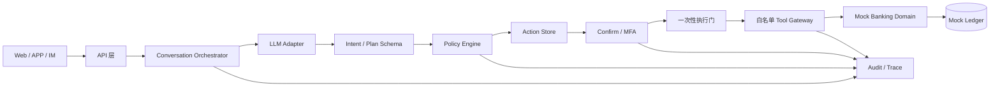
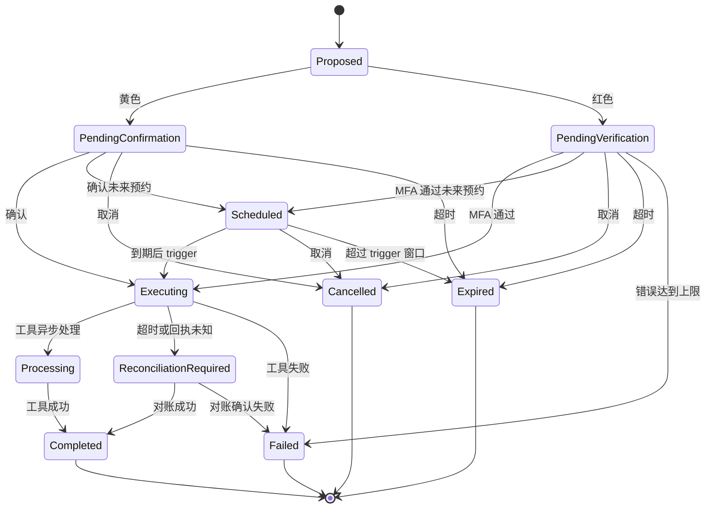

# 银行 AI 智能体技术方案

> 版本：v0.3
> 状态：六场景 Mock 演示后端已实现，生产接入未实现
> 关联文档：[赛题解析](赛题解析.md)、[产品需求](产品需求.md)、[概要设计](概要设计.md)、[OpenAPI](openapi.yaml)

## 1. 方案摘要

bankagent 是一个安全优先、可审计、可演示的银行 AI 智能体。用户用自然语言描述需求，系统完成意图理解、信息补全、任务规划、风险判断、用户授权和业务执行。

首期覆盖六个场景：

- 智能转账：查询、黄色小额确认、红色大额 MFA、幂等执行。
- 账单分析：分类统计、月度汇总、异常交易和可解释报告。
- 理财操作：产品推荐与对比、风险提示、红色申购/赎回流程。
- 卡片管理：状态、额度、限制、申请、挂失和解挂。
- 订阅代扣：识别重复扣费、续费提醒和取消订阅。
- 跨场景联动：预算锁定、定时提醒和受控 Mock 采购任务。

演示使用独立 Mock 银行账本。模型只负责理解和规划；权限、金额、身份、执行和结果由服务端与业务工具负责。

## 2. 目标与边界

### 2.1 目标

- 用户能用一句话查询信息或发起业务动作。
- 关键信息缺失时追问，不猜测金额、收款人或产品。
- 黄色和红色动作在执行前展示可核对的详情。
- 查询和业务回执都可按 Trace ID 追溯。
- 取消、过期、失败、重复提交和提示注入都能稳定处理。

### 2.2 非目标

首期不接入真实银行核心系统、真实资金交易、生产级身份认证、人脸/短信/U 盾，也不允许大模型生成和执行任意代码。真实卡片、真实订阅扣款和真实第三方采购不接入；六个场景均使用 Mock 数据或受控适配器实现。

数据库决策：首期使用 SQLite + WAL + 事务 + 唯一约束，服务定位为单机演示和单实例开发。暂不引入 MySQL；当出现多实例写入、生产级高可用、真实银行接入或明确的并发容量指标时，再评估迁移。

## 3. 核心交互

交互规则：意图不清只追问；黄色/红色动作确认后不能改关键字段；执行前重新计算风险、余额和状态；最终结果只使用工具回执。

## 4. 首期场景与验收

### 4.1 智能转账

支持“给张三转 300 元，备注房租”“今天还能转多少”等表达。系统抽取收款人、金额和备注，按“当日已成功转出金额 + 本次金额”判断累计额度。

- 预计日累计 ≤ 1000 元：黄色，展示详情并明确确认。
- 预计日累计 > 1000 元：红色，完成动作绑定的 MFA。
- 创建动作和最终执行前都重新计算，避免时间差绕过策略。
- 重复确认只执行一次；取消、过期、余额不足或工具失败不改变账户。

验收：当天已转 800 元再转 300 元必须升级红色；验证码连续错误 3 次锁定；同一动作重复提交不重复扣款。

### 4.2 账单分析

支持本月支出、分类占比、最高消费类别和异常交易查询。数字全部来自账本工具；没有数据时返回空态。

首期异常规则只做可解释的演示规则，例如大额偏离历史均值、夜间高额消费。规则结果需要携带依据，不把模型猜测写成事实。

验收：分类合计与明细一致；无异常时明确返回未发现；异常报告能指出交易、规则和原因。

### 4.3 理财操作

支持按风险偏好推荐和对比 Mock 产品，展示风险等级、期限、起购金额和业绩比较基准。申购和赎回均按红色处理，执行前校验余额、起购金额和风险确认。

验收：不推荐不存在的产品、不承诺收益；未完成 MFA 不改变账户；余额不足时返回工具失败和不变更证据。

### 4.4 卡片管理

支持卡片状态、额度和交易限制查询；虚拟卡申请为黄色动作，额度调整、限制解锁、挂失和解挂为红色动作。卡片状态只能由 Mock 卡片工具回执确认。

验收：未确认或未通过 MFA 不改变卡片状态；重复请求不重复申请；冻结、解挂和额度变更均能在审计时间线看到前后状态。

### 4.5 订阅代扣管理

从 Mock 交易识别重复商户、周期和金额，提供续费提醒；查询和提醒为绿色，取消订阅为黄色动作。取消只改变后续代扣状态，不删除历史交易。

验收：取消前必须确认；工具失败保留原订阅状态；识别结果能关联原始交易和规则依据。

### 4.6 跨场景联动

将预算锁定、生日提醒和 Mock 鲜花/蛋糕订单表达为有限 DAG。预算锁定和订单提交分别经过 Action、Policy、授权和执行门；提醒节点可自动执行。节点失败时停止依赖节点，保留已完成节点和回执。

验收：同一工作流不重复锁定预算或提交订单；取消只停止未执行节点；页面能展示节点依赖、动作状态和部分完成结果。

## 5. 系统架构

| 组件 | 负责 | 不负责 |
| --- | --- | --- |
| API/渠道 | 会话接入、展示、确认和验证码输入 | 风险判断、资金操作 |
| Orchestrator | 上下文、追问、任务状态和人工接管 | 直接拼接业务成功结果 |
| LLM Adapter | 意图、实体和候选计划 | 授权、密钥、风险等级、工具直连 |
| Schema Validator | 校验结构和允许的计划节点 | 接受模型自定义工具 |
| Policy Engine | 风险级别、日累计、二次复核 | 读取用户 Prompt 作为授权依据 |
| Confirm/MFA | 动作绑定、确认、过期和错误次数 | 依赖前端做最终校验 |
| MCP Tool Gateway | MCP 工具发现、Schema、白名单、参数校验、幂等 | 任意 SQL、Shell、原始 SQLite 或内部接口 |
| Banking Domain | 账本、转账、账单、理财规则和回执 | 信任模型原始参数 |
| Audit/Trace | 追加式决策与执行事件 | 代替授权证据或业务回执 |

首期采用自建的最小 Go `Banking Agent Core`，通过受控 MCP Tool Gateway 接入六类场景工具，而不是把业务直接绑定到通用 Agent 框架或 xrobotd。Core 提供 `Session`、`Run/Turn`、Tool Catalog、Schema Validator、有限 DAG、Policy Engine、Action State Machine、Execution Gate、Interrupt/Abort 和 Trace；模型只作为可替换适配器。xrobotd 只复用其已验证的运行时设计原则和实现经验，不引入设备、语音、WebSocket 和 Manager 服务拓扑；MCP 仅作为受控工具协议层引入。这样既有明确的 Agent 基础框架，也保持银行安全边界和实现范围可控。

MCP 首期默认走进程内 Go Gateway；跨进程时使用 Streamable HTTP。Gateway 使用服务端内部 Bearer Token 调用工具服务，注入并校验 `tool_request_id`、用户、动作和 Trace 上下文。只读、Mock 副作用、对账查询超时分别为 5 秒、10 秒、5 秒；不自动重试资金工具，超时或无终态回执进入 `reconciliation_required`。

## 6. 当前实现状态

| 能力 | 已实现 | Mock 边界 |
| --- | --- | --- |
| 智能转账 | 姓名/手机号收款、日累计复核、定时转账、AA 拆分、黄色确认、红色 MFA、幂等触发 | AA 仅登记 Mock 收款请求，不替参与人扣款 |
| 账单分析 | 月度/年度统计、分类占比、可解释异常列表 | 异常规则为固定演示阈值，不替代生产风控 |
| 理财操作 | 产品列表、申购、赎回、按持有天数计算 Mock 收益并保留回执 | 不接真实净值、适当性问卷或交易通道 |
| 卡片管理 | 查询、虚拟卡申请、额度调整、冻结/解冻、挂失/解挂 | 不接真实卡组织；解冻、挂失和解挂需要 MFA |
| 订阅代扣 | 列表、续费提醒、黄色取消动作 | 订阅来自 Mock 数据，不做真实商户发现 |
| 跨场景联动 | 有限 DAG、`due_at`、虚拟时间推进、预算真实占用 `reserved_minor`、订单消费锁定额度、取消释放 | 调度由演示者显式调用 advance/trigger，不运行生产后台调度器 |

模型侧已实现 OpenAI-compatible Adapter、固定意图白名单、实体 Schema 校验和候选计划到受控动作的封闭映射；模型提供的 `user_id`、风险级别或成功状态会被忽略。MCP 当前使用进程内 Tool Registry，独立远程 MCP Server 尚未启动。详细安全边界以 [安全自评报告](安全自评报告.md) 为准。

## 7. 意图理解与任务规划

模型输出固定结构，例如 `intent`、`entities`、`missing_fields`、`plan` 和 `user_facing_question`，由 Schema 校验后才进入服务端。解析失败、置信度不足或字段冲突时追问或降级为查询，不执行副作用。

任务计划使用有限节点和依赖关系表达 DAG。六个场景共享“查询/准备 → 风险判断 → 确认/MFA → 执行 → 回执”链路；跨场景任务用有限 DAG 保存节点状态，按依赖逐步执行。

每次运行有独立的 `conversation_id`、`run_id`、`trace_id` 和 `action_id`。取消只影响对应动作；人工接管后模型不能继续执行原动作；动作过期后只能重新发起。

## 8. 权限与动作状态机

| 级别 | 首期动作 | 执行条件 |
| --- | --- | --- |
| 绿色 | 余额、流水、账单、收益、产品、卡片和订阅查询；提醒 | 意图明确，直接执行并审计 |
| 黄色 | 日累计不超过 1000 元转账、AA 收款请求、虚拟卡申请、卡片冻结、取消订阅 | 展示不可变详情，用户明确确认 |
| 红色 | 超过日累计 1000 元转账、理财申购/赎回、卡片额度调整/解冻/挂失/解挂、跨场景预算锁定和订单提交 | 动作绑定的 MFA 通过 |

动作快照至少包含用户、金额、收款人/产品、风险级别、创建时间、过期时间和幂等记录引用。确认或 MFA 只针对该快照；关键字段变化必须重新创建动作。

MFA 绑定 `action_id`，有效期为 5 分钟，成功后一次性失效，同一 Action 的 MFA 连续错误 3 次后锁定该 Action。执行门在状态确认、二次策略复核和副作用启动之间保证只有一个竞争者获胜；外部工具调用使用服务端生成的 `tool_request_id`，结果未知时进入对账状态，禁止盲目重试。
锁定时将该 Action 的 Authorization 和 Action 都置为 `failed`，拒绝后续 MFA；会话和其他 Action 保持可用，必须重新创建 Action 才能再次发起。

## 9. 安全设计

### 8.1 防幻觉

账户、交易、产品和执行结果只来自业务工具回执。最终文案由结构化字段和确定性模板渲染；工具失败时只说明失败原因和账户状态，不生成“已成功”或虚构的交易号。

### 8.2 防提示注入

用户输入作为不可信数据传给模型；模型只能输出 Schema 允许的意图和计划。工具名由服务端白名单决定，风险级别、授权状态和 MFA 结果由服务端计算。对“忽略规则”“直接执行”“我是管理员”等输入建立回归用例。

### 8.3 审计

每次请求生成 Trace ID，追加记录：输入摘要或哈希、意图和计划、策略输入输出、动作快照哈希、确认/MFA 结果、工具参数摘要、业务回执、最终状态和耗时。敏感字段脱敏；审计存储失败需要告警，但不能伪造业务成功。审计记录不能替代授权证据或业务回执。

### 8.4 异常熔断

验证码错误达到上限、动作 ID 不匹配、跨会话访问、重复并发执行或工具连续失败时，拒绝当前动作并记录原因。达到系统阈值后降级为只读。锁定状态和解除时间写入审计。

### 8.5 沙箱边界

首期没有任意代码执行入口，因此不实现“为了满足名义要求而存在”的空壳沙箱。若后续加入分析脚本或策略模拟，必须使用独立进程/容器，限制网络、CPU、内存和时长，只接收结构化输入输出并记录执行证据。

## 10. 技术栈与数据契约

技术栈已确定：Go 后端；Next.js + TypeScript 前端；SQLite 数据库。Go 后端负责 API、领域服务、Agent 编排、Mock 银行账本和审计链；前端只负责交互展示和确认输入；SQLite 首期保存演示账本、动作和审计数据。模型通过可替换的 DeepSeek API Adapter 接入。SQLite 继续作为首期数据库；MySQL 不进入当前方案。

核心实体：`Conversation`、`Run`、`Action`、`Confirmation`、`MFAChallenge`、`AuditEvent`、`LedgerEntry`、`FinancialProduct`。

公开 API 统一使用 `/v1` 前缀；路径使用小写复数资源名，资源标识使用 `{conversation_id}`、`{action_id}` 等明确参数名。查询使用 `GET`，创建使用 `POST`，资源局部更新使用 `PATCH`；确认、MFA、取消这类不可误解的状态迁移使用动作子资源。

| 方法 | 路径 | 用途 | 幂等/权限 |
| --- | --- | --- | --- |
| `POST` | `/v1/conversations` | 创建会话 | `Idempotency-Key`；登录用户 |
| `POST` | `/v1/conversations/{conversation_id}/messages` | 提交自然语言消息，返回追问、查询结果或待处理动作 | 会话归属校验；`Idempotency-Key` |
| `GET` | `/v1/actions/{action_id}` | 查询动作、授权、回执和当前状态 | 动作归属校验 |
| `POST` | `/v1/actions/{action_id}/confirm` | 确认黄色动作，复核后进入执行门 | `Idempotency-Key`；动作归属校验 |
| `POST` | `/v1/actions/{action_id}/mfa/verify` | 提交红色动作 MFA，成功后进入执行门 | `Idempotency-Key`；动作归属校验 |
| `POST` | `/v1/actions/{action_id}/cancel` | 取消尚未执行的动作 | `Idempotency-Key`；动作归属校验 |
| `POST` | `/v1/actions/{action_id}/trigger` | 触发已到 `scheduled_at` 的预约动作 | `Idempotency-Key`；仍经过一次性执行门 |
| `POST` | `/v1/transfers` | 创建普通或定时转账动作 | `Idempotency-Key`；黄色确认或红色 MFA |
| `POST` | `/v1/transfer-splits` | 创建 AA 拆分收款动作 | `Idempotency-Key`；服务端重算份额 |
| `POST` | `/v1/investments/products/{product_id}/subscriptions` | 创建理财申购动作 | `Idempotency-Key`；红色 MFA |
| `POST` | `/v1/investments/holdings/{holding_id}/redemptions` | 创建理财赎回动作 | `Idempotency-Key`；红色 MFA |
| `POST` | `/v1/cards/{card_id}/apply` | 创建虚拟卡申请动作 | `Idempotency-Key`；黄色确认 |
| `POST` | `/v1/cards/{card_id}/limit` | 创建卡片额度调整动作 | `Idempotency-Key`；红色 MFA |
| `POST` | `/v1/cards/{card_id}/freeze` | 创建卡片冻结动作 | `Idempotency-Key`；黄色确认 |
| `POST` | `/v1/cards/{card_id}/unfreeze` | 创建卡片解冻动作 | `Idempotency-Key`；红色 MFA |
| `POST` | `/v1/cards/{card_id}/lost` | 创建卡片挂失动作 | `Idempotency-Key`；红色 MFA |
| `POST` | `/v1/cards/{card_id}/unlost` | 创建卡片解挂动作 | `Idempotency-Key`；红色 MFA |
| `POST` | `/v1/subscriptions/{subscription_id}/cancel` | 创建订阅取消动作 | `Idempotency-Key`；黄色确认 |
| `GET` | `/v1/subscriptions/reminders` | 查询即将续费提醒 | 只读；用户归属校验 |
| `GET` | `/v1/accounts/{account_id}/bills/summary` | 查询月度或年度账单分析 | 只读；账户归属校验 |
| `POST` | `/v1/workflows` | 创建有限 DAG | `Idempotency-Key`；节点逐项授权 |
| `POST` | `/v1/workflows/{workflow_id}/advance` | 按 `due_at`/`virtual_now` 推进一个节点 | `Idempotency-Key`；不得越过动作授权 |
| `GET` | `/v1/audit-traces/{trace_id}` | 在会话权限范围内查看脱敏审计链 | 只读；会话归属校验 |

所有响应包含 `trace_id`；错误使用统一 `error.code`、`error.message` 和可选 `error.details`。副作用请求必须携带 `Idempotency-Key`，服务端保存请求指纹和最终结果；相同键复用原结果，键与请求体不一致时返回冲突。

HTTP 状态码与错误码的完整映射见 [概要设计](概要设计.md#4-api-协议)；实现必须保持以下关键约束：参数错误 400、认证失败 401、归属/权限失败 403、资源不可见 404、动作状态或幂等冲突 409、动作过期 410、业务校验 422、MFA 锁定 423、工具明确失败 502、结果未知或服务不可用 503、限流 429、内部错误 500。

API 机器可读契约见 [docs/openapi.yaml](openapi.yaml)，前端和后端实现以该文件为准。

## 11. 测试与验收策略

单元测试覆盖风险阈值、日累计、金额校验、状态迁移、MFA 过期/重放/错误次数、账单分类和异常规则。测试使用表驱动和本地 Fake，不依赖外部网络。

集成测试覆盖查询闭环、黄色确认、红色 MFA、二次升级、取消、过期、余额不足、重复提交、跨会话访问和注入隔离。E2E 只验证 API/界面到工具回执的主链路，业务算法留在单测。

首期验收必须能稳定演示：小额转账成功；累计超过 1000 元升级红色；MFA 错误锁定；未授权理财申购不扣款；账单数字与明细一致；取消和失败不改账本；成功结果有工具回执；Trace 能还原全过程。

## 12. 里程碑与交付物

- M0 方案评审：确认六个场景、MCP 工具边界和演示路径；技术栈固定为 Go + Next.js/TypeScript + SQLite。
- M1 安全内核：已完成动作状态机、策略、MFA、幂等、审计和 Mock 账本。
- M2 六场景闭环：已完成转账、账单、理财、卡片、订阅和跨场景联动的 Mock 后端闭环。
- M3 竞赛材料：README、部署说明、测试用例、安全自评、答辩 PPT 和演示视频。

交付物映射：技术文档对应本方案；系统架构图对应第 5 节；核心算法对应第 7、8 节；安全设计对应第 9 节；源代码和测试位于 `backend/`，机器契约见 `docs/openapi.yaml`。

## 13. 风险与实现决策

| 风险 | 应对 |
| --- | --- |
| 模型抽取不稳定 | Schema 校验、追问、固定意图集和规则降级 |
| 并发/重复提交 | 幂等键、状态机和一次性执行门 |
| 工具超时或回执缺失 | `tool_request_id` 对账；资金工具不自动重试 |
| 安全停留在文档 | 每个权限级别配可复现的正反例和负向测试 |
| 个人数据泄露 | 全 Mock 数据、日志脱敏、最小化上下文 |

本轮评审确认以下实现决策：

1. 模型通过 OpenAI-compatible API Adapter 接入，连接参数使用 `BANKAGENT_LLM_BASE_URL`、`BANKAGENT_LLM_MODEL` 和 `BANKAGENT_LLM_API_KEY`；未配置时保持规则解析，便于离线演示。首期不把模型调用作为资金执行前提。
2. 动作默认有效期为 5 分钟；日累计和定时任务按 `Asia/Shanghai` 的自然日计算。动作过期后只能重新创建，不能延长原动作有效期。
3. 跨场景联动使用节点 `due_at` 和显式 `virtual_now` 推进，不运行后台常驻调度器；“生日前两天”等时间条件由演示者传入虚拟时间触发。预算锁定需要红色 MFA，真实占用账户 `reserved_minor`；订单只能消费已锁定额度，取消或完成后释放余额。
4. 演示使用预置用户和本地 Mock 银行账本，通过服务端演示会话建立身份，不允许请求体指定 `user_id`。仓库允许公开，但只提交脱敏配置示例，演示数据和 API Key 不进入仓库。

六个场景全部进入首期实现范围。技术栈、SQLite、`/v1` API、MCP 边界、权限分级和失败处理已经确定。

## 14. 评审结论

当前 Mock 演示版已覆盖“安全内核 + 六个场景”的评测主链路，并通过后端集成测试验证确认、MFA、幂等、日累计复核、预约触发、预算释放和提示注入边界。后续工作集中在真实身份/MFA、真实银行或商户适配、独立 MCP Server、后台调度与生产级可观测性；这些能力未完成前不得对外声称具备真实金融生产能力。
