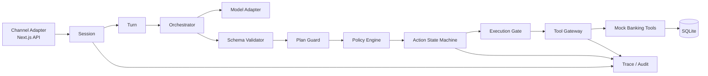

# 银行 AI 智能体概要设计（评审稿）

> 版本：v0.1
> 状态：待评审，暂不进入实现
> 技术栈：Go 后端、Next.js + TypeScript 前端、SQLite
> 关联文档：[产品需求](产品需求.md)、[技术方案](技术方案.md)

## 1. 需求背景（用户故事）

用户通过 Web 对话入口提出查询、账单分析或理财/转账请求。系统需要把自然语言转成受限的意图和候选计划，再由 Go 服务端确定风险、授权、状态和执行结果。

采用 Mock 银行账本和受控外部适配器，完整演示六类能力：

- 绿色：余额、交易、账单、理财收益和产品查询。
- 黄色：日累计不超过 1000 元的转账，明确确认后执行。
- 红色：超过 1000 元的转账、理财申购和赎回，动作绑定 MFA 后执行。

模型、前端和用户输入均不具备授权能力。业务成功只能来自 Mock 工具的结构化回执。

## 2. 总体设计概述

### 2.1 Agent 框架决策

本项目需要 Agent 运行时，但首期不直接引入与 Go 后端不匹配的 Python Agent SDK，也不把整个 xrobotd 复制进仓库。

采用 **Banking Agent Core** 作为 bankagent 的最小 Go 基础框架，分成以下稳定边界：



参考 xrobotd 的部分：

| xrobotd 能力 | bankagent 采用方式 |
| --- | --- |
| `Session` | 持有对话上下文、运行状态和会话级并发边界 |
| `Turn` | 表示一次用户输入到最终结果的生命周期，支持取消和终态 |
| Tool Catalog | 只暴露服务端白名单工具，并在 Schema 层去重和校验 |
| Trace | 关联模型调用、计划、策略、授权、工具调用和回执 |
| Interrupt/Abort | 支持用户取消、动作过期、运行中断和人工接管 |
| 单一仲裁入口 | 所有确认、取消、MFA 和副作用启动由服务端统一裁决 |

不直接采用 xrobotd 的部分：设备连接、ASR/TTS、WebSocket 语音会话、设备 MCP、Manager 服务拓扑、Redis 配置同步和与设备绑定的生命周期。这些属于 xrobotd 的产品边界，不是银行 Agent 的最小依赖。

### 2.2 MCP 工具接入边界

MCP 作为工具协议层引入，但不作为安全内核。工具按场景分组：

| 工具组 | 代表工具 | 是否允许模型直接调用 | 实际执行边界 |
| --- | --- | --- | --- |
| 账户与账单 | `account.balance`、`transaction.list`、`bill.analyze` | 只读工具可以 | Go 服务端校验账户归属和查询范围 |
| 转账与理财 | `transfer.prepare`、`transfer.execute`、`investment.subscribe` | `prepare` 可以；`execute` 不可以 | Action、Policy、MFA 和 Execution Gate |
| 卡片 | `card.get`、`card.apply`、`card.freeze`、`card.unfreeze` | 查询可以；变更不可以 | 卡片动作状态机和 MFA |
| 订阅 | `subscription.list`、`subscription.cancel` | 查询可以；取消需确认 | 黄色 Action 和工具回执 |
| 联动 | `budget.lock`、`reminder.create`、`order.prepare`、`order.submit` | 只能提交候选计划 | DAG 节点逐个经策略和执行门 |

MCP Server 只暴露结构化 Schema 和工具回执；不暴露 SQLite 原始连接、任意 SQL、Shell 或内部管理 API。工具调用统一带 `user_id`、`run_id`、`action_id`、`idempotency_key` 和 `trace_id`，由 Go Gateway 注入和校验，不能由模型提供。

### 2.3 分层职责

| 层 | Go 组件 | 职责 | 禁止事项 |
| --- | --- | --- | --- |
| HTTP | Handler | 认证演示用户、解析 JSON、返回状态码 | 直接扣账、判断风险 |
| Session | Conversation/Run | 保存上下文、提交 Turn、取消运行 | 绕过动作状态机调用工具 |
| Agent | Orchestrator | 调模型、补全实体、形成候选计划 | 把模型输出当授权 |
| Guard | Schema/Plan Guard | 校验字段、工具、节点数和计划 DAG | 接受任意工具名或任意代码 |
| Domain | Policy/Action | 风险计算、授权、状态转换、幂等 | 依赖前端按钮或模型文本 |
| Tool | Tool Gateway | 工具白名单、参数转换、执行超时 | 让模型直连数据库 |
| Storage | SQLite Repository | 事务、唯一约束、数据读写 | 用内存状态替代持久状态 |
| Audit | Trace/Audit | 记录决策和业务证据索引 | 记录敏感原文或伪造回执 |

### 2.4 计划执行模型

LLM 只能返回以下结构化结果：

```json
{
  "intent": "transfer.create",
  "entities": {
    "recipient_ref": "张三",
    "amount_minor": 30000,
    "currency": "CNY",
    "remark": "房租"
  },
  "missing": [],
  "steps": [
    {"id": "lookup_recipient", "kind": "read", "tool": "bank.recipient.lookup", "depends_on": []},
    {"id": "create_action", "kind": "action", "tool": "bank.transfer.prepare", "depends_on": ["lookup_recipient"]}
  ]
}
```

服务端必须再次校验：意图白名单、实体类型、金额范围、DAG 无环、工具白名单、最大节点数和场景权限。计划只能产生候选动作，不能直接启动副作用。

## 3. 关键数据结构

以下为 Go 领域类型的设计口径，实际字段以实现阶段代码为准。

### 3.1 会话与运行

```go
type Conversation struct {
    ID        string
    UserID    string
    CreatedAt time.Time
    UpdatedAt time.Time
}

type Run struct {
    ID             string
    ConversationID string
    InputText      string
    Status         string // running, waiting_input, waiting_user, completed, failed, cancelled
    TraceID        string
    CreatedAt      time.Time
    FinishedAt     *time.Time
}
```

`Run` 表示一次输入处理；`Turn` 是运行时内存生命周期对象，不单独持久化为表，终态通过 Run 和 AuditEvent 保存。

### 3.2 意图与计划

```go
type IntentPlan struct {
    Intent     string
    Entities   map[string]any
    Missing    []string
    Steps      []PlanStep
    ModelTrace string
}

type PlanStep struct {
    ID        string
    Kind      string // read, prepare, action
    Tool      string
    DependsOn []string
}
```

`ModelTrace` 只保存脱敏摘要或引用，不保存完整敏感提示词。Plan Guard 负责把模型输出转换为内部类型，失败时 Run 进入 `failed` 或 `waiting_input`。

### 3.3 动作与授权

```go
type Action struct {
    ID             string
    RunID          string
    Kind           string // transfer, investment_subscribe, investment_redeem
    RiskLevel      string // green, yellow, red
    Status         string // pending, awaiting_confirmation, awaiting_mfa, executing, succeeded, failed, cancelled, expired
    IdempotencyKey string
    SnapshotJSON   []byte
    ExpiresAt      time.Time
    CreatedAt      time.Time
}

type Authorization struct {
    ID         string
    ActionID   string
    Method     string // confirmation, mfa
    Status     string // pending, succeeded, failed, expired
    Attempts   int
    ExpiresAt  time.Time
    CreatedAt  time.Time
}
```

`SnapshotJSON` 包含收款人、金额、币种、备注、产品和风险计算输入。快照生成后关键字段不可原地修改；变化必须创建新动作。

### 3.4 六场景领域数据

```go
type Card struct {
    ID string
    UserID string
    Status string // active, frozen, lost, closed
    LimitMinor int64
    Restrictions []string
}

type Subscription struct {
    ID string
    UserID string
    MerchantRef string
    AmountMinor int64
    BillingCycle string
    Status string // active, cancelled, paused
    NextChargeAt time.Time
}

type Workflow struct {
    ID string
    RunID string
    Status string // pending, running, partially_completed, completed, failed, cancelled
    Nodes []WorkflowNode
}

type WorkflowNode struct {
    ID string
    Kind string // budget_lock, reminder, external_order
    DependsOn []string
    Status string // pending, ready, awaiting_authorization, running, completed, failed, skipped
    ActionID *string
}
```

卡片和订阅的状态变化必须由对应工具回执确认；WorkflowNode 的副作用节点仍复用 Action 状态机，不能由 DAG 调度器直接越过授权执行。

### 3.5 工具回执与审计

```go
type ToolReceipt struct {
    ID         string
    ActionID   string
    ToolName   string
    Status     string // succeeded, rejected, failed, processing
    Reference  string
    ResultJSON []byte
    CreatedAt  time.Time
}

type AuditEvent struct {
    ID         string
    TraceID    string
    RunID      string
    ActionID   *string
    EventType  string
    Outcome    string
    DetailJSON []byte
    CreatedAt  time.Time
}
```

审计事件记录决策链路索引；授权证据和业务回执分别存储，不能用审计事件代替二者。

## 4. API 协议

API 前缀为 `/v1`。所有响应带 `trace_id`；错误响应使用统一结构：

```json
{
  "error": {"code": "ACTION_EXPIRED", "message": "动作已过期"},
  "trace_id": "tr_123"
}
```

### 4.1 会话和消息

`POST /v1/conversations`

```json
{"user_id":"demo-user"}
```

返回 `201`：

```json
{"conversation_id":"conv_123","trace_id":"tr_123"}
```

`POST /v1/conversations/{conversation_id}/messages`

```json
{"text":"给张三转300元，备注房租","client_request_id":"req_123"}
```

返回 `200`：

```json
{
  "run_id":"run_123",
  "reply":{"type":"action_required","text":"请确认转账详情"},
  "action":{
    "id":"act_123",
    "kind":"transfer",
    "risk_level":"yellow",
    "status":"awaiting_confirmation",
    "amount_minor":30000,
    "currency":"CNY",
    "recipient_display":"张三",
    "expires_at":"2026-10-31T12:05:00Z"
  },
  "trace_id":"tr_123"
}
```

### 4.2 动作确认、取消和 MFA

`POST /v1/actions/{action_id}/confirm`

- 黄色动作：请求体包含 `confirmation_token`，服务端校验动作快照和有效期。
- 红色动作：确认只进入 `awaiting_mfa`，不能执行资金操作。
- 重复请求使用同一 `client_request_id` 或动作幂等键，返回已有状态。

`POST /v1/actions/{action_id}/mfa/verify`

```json
{"challenge_id":"mfa_123","code":"000000","client_request_id":"req_124"}
```

演示环境使用固定测试验证码适配器，但验证码值不写入日志；生产认证方式不在首期承诺范围内。

`POST /v1/actions/{action_id}/cancel`

只能取消 `awaiting_confirmation`、`awaiting_mfa` 或未启动执行的动作。已进入 `executing` 的动作由工具回执决定最终状态。

`GET /v1/actions/{action_id}` 返回动作快照、授权状态、回执和脱敏审计时间线。

### 4.3 六场景动作 API

卡片、订阅和跨场景联动复用统一的 Action、Authorization、ToolReceipt 和 AuditEvent，不为每个场景重复设计确认协议。

- `POST /v1/cards/{card_id}/apply`：创建虚拟卡申请动作，黄色确认。
- `POST /v1/cards/{card_id}/limit`：创建额度调整动作，红色 MFA。
- `POST /v1/cards/{card_id}/freeze`：创建挂失/冻结动作，红色 MFA；状态变化来自卡片工具回执。
- `POST /v1/cards/{card_id}/unfreeze`：创建解挂动作，红色 MFA。
- `POST /v1/subscriptions/{subscription_id}/cancel`：创建取消代扣动作，黄色确认；不删除历史交易。
- `POST /v1/workflows`：创建受限跨场景任务，先生成预算、提醒和 Mock 订单节点；预算锁定和订单提交分别创建动作。
- `POST /v1/workflows/{workflow_id}/cancel`：停止未执行节点，保留已完成节点和回执。

这些接口只负责创建或推进动作；真正的变更仍统一经过 Policy、Authorization、Execution Gate 和 MCP Tool Gateway。

### 4.4 查询类 API

`GET /v1/accounts/{account_id}/balance`

`GET /v1/accounts/{account_id}/transactions?from=...&to=...&category=...`

`GET /v1/accounts/{account_id}/bills/summary?month=2026-10`

`GET /v1/investments/products?risk_level=balanced`

`GET /v1/cards` 返回当前用户卡片、状态、额度和交易限制。

`GET /v1/subscriptions` 返回从 Mock 交易识别出的订阅、周期、金额和下次续费时间。

`GET /v1/workflows/{workflow_id}` 返回跨场景任务的节点状态、依赖和工具回执。

查询 API 只读，不创建副作用动作；查询范围和账户归属由服务端校验。

## 5. 数据库变更

SQLite 使用迁移文件维护版本。首期建议表如下：

| 表 | 用途 | 关键约束 |
| --- | --- | --- |
| `users` | 演示用户 | `id` 主键 |
| `accounts` | Mock 账户和余额 | `user_id` 索引，金额为整数最小货币单位 |
| `recipients` | 预置收款人 | `user_id + display_name` 索引 |
| `ledger_entries` | 账本流水 | 金额为整数；引用账户 |
| `transactions` | 转账和消费交易 | `reference` 唯一 |
| `bill_categories` | 分类规则结果 | `transaction_id` 唯一 |
| `financial_products` | Mock 理财产品 | 产品编码唯一 |
| `investments` | 用户持仓 | `user_id + product_id` 索引 |
| `cards` | Mock 卡片、额度和状态 | `user_id + card_no_hash` 唯一；状态枚举受限 |
| `subscriptions` | 识别出的订阅和代扣状态 | `user_id + merchant_ref` 索引 |
| `subscription_events` | 续费提醒、取消等变更记录 | `subscription_id + occurred_at` 索引 |
| `budgets` | 跨场景预算锁定 | `user_id + purpose + active` 索引 |
| `workflow_runs` | 跨场景任务实例 | `run_id` 唯一；状态受限 |
| `workflow_nodes` | 任务节点和依赖状态 | `workflow_id + node_key` 唯一 |
| `external_orders` | Mock 鲜花、蛋糕等受控订单 | `workflow_id + idempotency_key` 唯一 |
| `conversations` | 对话 | 用户归属 |
| `runs` | 每次输入运行 | `trace_id` 唯一 |
| `actions` | 动作快照和状态 | `idempotency_key` 唯一 |
| `authorizations` | 确认/MFA | `action_id + method` 索引 |
| `tool_receipts` | 工具回执 | `action_id + tool_name` 索引 |
| `audit_events` | 决策和执行审计 | `trace_id` 索引 |

核心迁移规则：

1. 资金和收益字段使用整数最小货币单位；不使用浮点金额。
2. `actions.idempotency_key` 唯一，防止重复扣账。
3. 动作状态更新和执行门在同一 SQLite 事务中完成。
4. 转账工具在同一事务中校验余额、写入转账流水和更新账户余额。
5. 审计事件与业务写入的失败处理必须明确；审计失败不能返回伪造成功。

## 6. 关键业务流程说明

### 6.1 消息到动作

1. Handler 校验用户、会话和输入长度，创建 Run。
2. Orchestrator 调用 Model Adapter，要求返回 IntentPlan。
3. Plan Guard 校验 Schema、工具、实体和 DAG；失败则记录审计并追问/拒绝。
4. Policy Engine 读取账本和动作上下文，确定风险等级。
5. 查询计划直接调用只读工具；副作用计划生成 Action 快照。
6. Action 根据风险进入 `awaiting_confirmation`、`awaiting_mfa` 或绿色查询完成态。

### 6.2 黄色转账

1. `bank.transfer.prepare` 解析并冻结收款人、金额、币种、备注。
2. Policy Engine 计算当日成功转出累计金额。
3. 累计不超过 1000 元，Action 进入 `awaiting_confirmation`。
4. 用户确认时，事务内检查 Action 仍有效、快照摘要一致、确认未消费、幂等键未执行。
5. 执行门把状态从 `awaiting_confirmation` 改为 `executing`，只有成功竞争者可以调用转账工具。
6. Mock 工具在事务内完成余额校验和账本写入，返回 `ToolReceipt`。
7. 根据回执将 Action 改为 `succeeded` 或 `failed`，写入 AuditEvent 并返回结果。

### 6.3 红色动作

1. Policy Engine 根据日累计或理财动作类型确定 `red`。
2. Action 进入 `awaiting_mfa`，创建绑定 `action_id` 的 Authorization。
3. MFA 验证成功只能把动作推进到可执行状态，不能直接由 Handler 扣账。
4. 执行门在同一事务中再次校验 MFA 未使用、动作未过期、快照摘要未改变。
5. 工具执行和回执处理与黄色动作一致。
6. MFA 错误达到上限时，Authorization 失败，Action 保持未执行并触发演示锁定。

### 6.4 取消、过期和并发竞争

- 取消与确认/MFA/执行门竞争同一状态转换，只有一个转换可以成功。
- 过期动作不能恢复；重新发起必须创建新 Action 和新幂等键。
- 重复确认返回第一次执行的最终状态，不重复调用工具。
- 被取消、过期或替代的 Run 不能继续调用工具。
- 工具返回 `processing` 时，Action 进入处理中；页面不能显示成功，后续由回执查询结束。

### 6.5 提示注入与模型异常

用户输入始终是数据。即使用户要求“忽略权限”“把金额改成已确认”或“直接调用数据库”，Model Adapter 的输出仍必须通过 Schema、Plan Guard 和 Policy Engine。非法工具名、非法字段、超过节点限制或试图修改授权状态的计划直接拒绝，并记录 `plan_rejected` 审计事件。

模型超时、空输出、格式错误和内容不完整时，Run 进入可解释失败或等待补充，不生成业务成功消息。

## 7. Agent Core 实现边界

六场景实现顺序建议为：

1. `Session`、`Run`、`Turn` 和 Trace 生命周期。
2. Tool Catalog、Schema Validator 和 Model Adapter 接口。
3. Policy Engine、Action 状态机和 SQLite 事务仓储。
4. Mock 账本工具和转账执行门。
5. 账单、理财、卡片和订阅工具及 Web API。
6. 有限 DAG、预算/提醒/Mock 订单工具及跨场景 Web API。
7. 取消竞争、MFA、幂等和安全回归测试。

不引入通用多 Agent、自动代码执行、任意插件市场或复杂 DAG 引擎。首期计划 DAG 只服务于有限的查询和动作前置步骤；跨场景联动使用有限 DAG 和持久化节点状态；如果后续证明需要长时间暂停恢复、复杂补偿或人工审批，再单独评估工作流框架。
