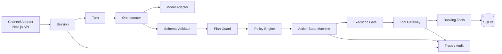

# 银行 AI 智能体概要设计

> 版本：v0.2
> 状态：普通用户版本已实现
> 技术栈：Go 后端、Next.js + TypeScript 前端、SQLite
> 关联文档：[产品需求](产品需求.md)、[技术方案](技术方案.md)、[OpenAPI](openapi.yaml)

## 1. 需求背景（用户故事）

用户通过 Web 对话入口提出查询、账单分析或理财/转账请求。系统需要把自然语言转成受限的意图和候选计划，再由 Go 服务端确定风险、授权、状态和执行结果。

采用本地账本和受控外部适配器，完整演示六类能力：

- 绿色：余额、交易、账单、理财收益、产品、卡片和订阅查询，以及提醒。
- 黄色：日累计不超过 1000 元的转账、虚拟卡申请和取消订阅，明确确认后执行。
- 红色：超过 1000 元的转账、理财申购/赎回、卡片高风险操作和跨场景副作用，动作绑定 MFA 后执行。

模型、前端和用户输入均不具备授权能力。业务成功只能来自业务工具的结构化回执。

## 2. 总体设计概述

### 2.1 Agent 框架决策

本项目需要 Agent 运行时，但首期不直接引入与 Go 后端不匹配的 Python Agent SDK，也不复制与本场景无关的通用 Agent 平台能力。

采用 **Banking Agent Core** 作为 bankagent 的最小 Go 基础框架，分成以下稳定边界：



首期最小运行时包含以下能力：

| 运行时能力 | bankagent 采用方式 |
| --- | --- |
| `Session` | 持有对话上下文、运行状态和会话级并发边界 |
| `Turn` | 表示一次用户输入到最终结果的生命周期，支持取消和终态 |
| Tool Catalog | 只暴露服务端白名单工具，并在 Schema 层去重和校验 |
| Trace | 关联模型调用、计划、策略、授权、工具调用和回执 |
| Interrupt/Abort | 支持用户取消、动作过期、运行中断和人工接管 |
| 单一仲裁入口 | 所有确认、取消、MFA 和副作用启动由服务端统一裁决 |

首期不包含设备连接、语音会话、外部 MCP Server、多实例编排、后台调度平台和与银行业务无关的运行时能力。

### 2.2 工具接入边界与未来 MCP 扩展

当前六场景由 Go 服务端白名单领域工具直接执行，不运行独立 MCP Server。MCP 仅作为未来跨进程或跨语言工具的协议扩展，不作为安全内核。工具按场景分组：

| 工具组 | 代表工具 | 是否允许模型直接调用 | 实际执行边界 |
| --- | --- | --- | --- |
| 账户与账单 | `account.balance`、`transaction.list`、`bill.analyze` | 只读工具可以 | Go 服务端校验账户归属和查询范围 |
| 转账与理财 | `transfer.prepare`、`transfer.execute`、`investment.subscribe` | `prepare` 可以；`execute` 不可以 | Action、Policy、MFA 和 Execution Gate |
| 卡片 | `card.get`、`card.apply`、`card.freeze`、`card.unfreeze` | 查询可以；变更不可以 | 卡片动作状态机和 MFA |
| 订阅 | `subscription.list`、`subscription.cancel` | 查询可以；取消需确认 | 黄色 Action 和工具回执 |
| 联动 | `budget.lock`、`reminder.create`、`order.prepare`、`order.submit` | 只能提交候选计划 | DAG 节点逐个经策略和执行门 |

未来 MCP Server 只暴露结构化 Schema 和工具回执；不暴露 SQLite 原始连接、任意 SQL、Shell 或内部管理 API。工具调用统一带 `user_id`、`run_id`、`action_id`、`idempotency_key` 和 `trace_id`，由 Go 核心服务注入和校验，不能由模型提供。

未来 MCP 接入必须满足以下约束：

- 传输：当前不启动 MCP；未来需要跨进程时使用 MCP Streamable HTTP，不采用旧 SSE 作为首选。
- 认证：Gateway 到工具服务使用服务端配置的内部 Bearer Token。Token 不进入模型上下文、Prompt、前端或审计详情。
- 上下文：`tool_request_id`、`user_id`、`run_id`、`action_id`、`trace_id` 由核心服务注入；工具服务必须校验，模型不能提供或覆盖。
- 超时：只读工具 5 秒，副作用工具 10 秒，对账查询 5 秒；单次调用不自动重试，资金类工具禁止重试。超时、断开或缺少终态回执统一进入 `reconciliation_required`。
- 模型：首期使用 OpenAI-compatible API Adapter，服务端通过 `BANKAGENT_LLM_BASE_URL`、`BANKAGENT_LLM_API_KEY`、`BANKAGENT_LLM_MODEL` 配置；未配置时使用现有规则解析。模型只返回结构化候选意图，不能调用账本或决定授权。
- 时间：动作默认有效期 5 分钟，业务日和定时任务使用 `Asia/Shanghai`；跨场景演示可注入虚拟时钟。
- 返回体：工具回执限制大小并要求结构化 Schema；只有按 `tool_request_id` 对账确认后，动作才能结束对账状态。

### 2.3 分层职责

| 层 | Go 组件 | 职责 | 禁止事项 |
| --- | --- | --- | --- |
| HTTP | Handler | 认证演示用户、解析 JSON、返回状态码 | 直接扣账、判断风险 |
| Session | Conversation/Run | 保存上下文、提交 Turn、取消运行 | 绕过动作状态机调用工具 |
| Agent | Orchestrator | 调模型、补全实体、形成候选计划 | 把模型输出当授权 |
| Guard | Schema/Plan Guard | 校验字段、工具、节点数和计划 DAG | 接受任意工具名或任意代码 |
| Domain | Policy/Action | 风险计算、授权、状态转换、幂等 | 依赖前端按钮或模型文本 |
| Tool | Tool Gateway | 工具白名单、参数转换、执行超时 | 让模型直连数据库 |
| Storage | SQLite Repository | 事务、唯一约束、数据读写 | 用内存状态替代持久状态 |
| Audit | Trace/Audit | 记录决策和业务证据索引 | 记录敏感原文或伪造回执 |

### 2.4 计划执行模型

LLM 只能返回以下结构化结果：

```json
{
  "intent": "transfer.create",
  "entities": {
    "recipient_ref": "张三",
    "amount_minor": 30000,
    "currency": "CNY",
    "remark": "房租"
  },
  "missing": [],
  "steps": [
    {"id": "lookup_recipient", "kind": "read", "tool": "bank.recipient.lookup", "depends_on": []},
    {"id": "create_action", "kind": "action", "tool": "bank.transfer.prepare", "depends_on": ["lookup_recipient"]}
  ]
}
```

服务端必须再次校验：意图白名单、实体类型、金额范围、DAG 无环、工具白名单、最大节点数和场景权限。计划只能产生候选动作，不能直接启动副作用。

## 3. 关键数据结构

以下为 Go 领域类型的设计口径，实际字段以实现阶段代码为准。

### 3.1 会话与运行

```go
type Conversation struct {
    ID        string
    UserID    string
    CreatedAt time.Time
    UpdatedAt time.Time
}

type Run struct {
    ID             string
    ConversationID string
    TraceID        string
    Status         string // running, completed, failed, interrupted, human_handoff, rolled_back, rollback_review_required
    Reason         string
    HandoffTo      string
    CreatedAt      time.Time
    UpdatedAt      time.Time
    FinishedAt     *time.Time
}
```

`Run` 表示一次输入处理；`Turn` 是运行时内存生命周期对象，不单独持久化为表，终态通过 Run 和 AuditEvent 保存。

### 3.2 意图与计划

```go
type IntentPlan struct {
    Intent     string
    Entities   map[string]any
    Missing    []string
    Steps      []PlanStep
    ModelTrace string
}

type PlanStep struct {
    ID        string
    Kind      string // read, prepare, action
    Tool      string
    DependsOn []string
}
```

`ModelTrace` 只保存脱敏摘要或引用，不保存完整敏感提示词。Plan Guard 负责把模型输出转换为内部类型，失败时 Run 进入 `failed` 或 `waiting_input`。

### 3.3 动作与授权

```go
type Action struct {
    ID             string
    TraceID        string
    RunID          string
    Kind           string // transfer, investment_subscribe, investment_redeem
    RiskLevel      string // green, yellow, red
    Status         string // awaiting_confirmation, awaiting_mfa, scheduled, executing, processing, reconciliation_required, succeeded, failed, cancelled, expired
    IdempotencyKey string
    SnapshotJSON   []byte
    SnapshotHash   string
    ExpiresAt      time.Time
    CreatedAt      time.Time
}

type Authorization struct {
    ID         string
    ActionID   string
    Method     string // confirmation, mfa
    Status     string // pending, succeeded, failed, expired
    Attempts   int
    ExpiresAt  time.Time
    CreatedAt  time.Time
}
```

`SnapshotJSON` 包含收款人、金额、币种、备注、产品和风险计算输入。快照生成后关键字段不可原地修改；变化必须创建新动作。

### 3.4 六场景领域数据

```go
type Card struct {
    ID string
    UserID string
    Status string // active, frozen, lost, closed
    LimitMinor int64
    Restrictions []string
}

type Subscription struct {
    ID string
    UserID string
    MerchantRef string
    AmountMinor int64
    BillingCycle string
    Status string // active, cancelled, paused
    NextChargeAt time.Time
}

type Workflow struct {
    ID string
    RunID string
    Status string // pending, running, partially_completed, completed, failed, cancelled
    Nodes []WorkflowNode
}

type WorkflowNode struct {
    ID string
    Kind string // budget_lock, reminder, external_order
    DependsOn []string
    Status string // pending, ready, awaiting_authorization, running, completed, failed, skipped
    ActionID *string
}
```

卡片和订阅的状态变化必须由对应工具回执确认；WorkflowNode 的副作用节点仍复用 Action 状态机，不能由 DAG 调度器直接越过授权执行。

### 3.5 工具回执与审计

```go
type ToolReceipt struct {
    ID         string
    ActionID   string
    ToolName   string
    Status     string // succeeded, rejected, failed, processing, unknown
    Reference  string
    ResultJSON []byte
    CreatedAt  time.Time
}

type AuditEvent struct {
    ID         string
    TraceID    string
    RunID      string
    ActionID   *string
    EventType  string
    Outcome    string
    DetailJSON []byte
    CreatedAt  time.Time
    Sequence   int64
}
```

审计事件记录决策链路索引；授权证据和业务回执分别存储，不能用审计事件代替二者。

### 3.6 流动性数字孪生

```go
type CashflowEvent struct {
    Direction   string
    AmountMinor int64
    Essential   bool
    ExpectedAt  time.Time
    Frequency   string
}

type LiquiditySimulation struct {
    ID                     string
    StartingAvailableMinor int64
    ProposedBudgetMinor    int64
    EssentialBufferMinor   int64
    MaximumSafeBudgetMinor int64
    Verdict                string
    Events                 []LiquidityEvent
    Scenarios              []LiquidityScenario
}
```

`LiquidityScenario` 保存必要支出、预期、保守和收入压力四种逐日曲线；`LiquidityEvent` 保存来源、方向、金额和是否必要支出。模拟结果只读，不创建 Action，不修改余额或预算锁。

## 4. API 协议

完整契约见 [OpenAPI 文档](openapi.yaml)。API 前缀为 `/v1`，响应统一使用 `{data, trace_id}`，错误统一使用 `{error, trace_id}`；错误通过 HTTP 状态码和稳定的 `error.code` 表达。

```json
{
  "error": {"code": "ACTION_EXPIRED", "message": "动作已过期", "details": {}},
  "trace_id": "tr_123"
}
```

HTTP 状态码与稳定错误码映射如下，Handler 必须按此表返回；同一错误不得在不同接口使用不同状态码：

| HTTP | `error.code` | 使用场景 |
| --- | --- | --- |
| 400 | `INVALID_ARGUMENT` | JSON、参数或 Header 格式错误 |
| 401 | `UNAUTHENTICATED` | 缺失或无效认证 |
| 403 | `PERMISSION_DENIED` | 资源不属于当前用户或无权访问 |
| 404 | `NOT_FOUND` | 资源不存在或不可见 |
| 409 | `ACTION_STATE_CONFLICT` | 当前动作状态不允许该操作 |
| 409 | `IDEMPOTENCY_CONFLICT` | 幂等键复用但请求指纹不同 |
| 409 | `IDEMPOTENCY_IN_PROGRESS` | 相同幂等键的首个请求尚未完成 |
| 410 | `ACTION_EXPIRED` | 动作已过期 |
| 422 | `MFA_INVALID` | MFA 校验失败但尚未达到上限 |
| 423 | `MFA_LOCKED` | 同一 Action 的 MFA 错误达到 3 次 |
| 423 | `SECURITY_LOCKED` | 同一用户连续异常操作，写操作临时锁定 |
| 422 | `INSUFFICIENT_BALANCE` / `PLAN_REJECTED` | 余额不足或计划未通过安全校验 |
| 502 | `TOOL_REJECTED` / `TOOL_FAILED` | 受控业务工具明确拒绝或失败 |
| 503 | `EXECUTION_UNKNOWN` / `SERVICE_UNAVAILABLE` | 结果未知需对账或服务暂不可用 |
| 429 | `RATE_LIMITED` | 请求或验证频率超限 |
| 500 | `INTERNAL` | 未分类内部错误 |

MFA 连续失败先锁定当前 `Action`：服务端将其 `Authorization.status` 和 `Action.status` 置为 `failed`。同一用户在 10 分钟内累计 6 次 MFA 失败或可疑输入时，额外触发 15 分钟用户级写操作锁定；只读查询仍可用。

### 4.1 会话和消息

`POST /v1/conversations`

```json
{}
```

用户身份从认证上下文获取，不能由请求体指定。演示环境使用预置用户和服务端演示会话，不实现真实登录；生产认证不在首期范围内。

返回 `201`：

```json
{"data":{"conversation_id":"conv_123","created_at":"2026-10-31T12:00:00Z"},"trace_id":"tr_123"}
```

`POST /v1/conversations/{conversation_id}/messages`

请求头：`Idempotency-Key: msg_12345678`

```json
{"text":"给张三转300元，备注房租"}
```

返回 `200`：

```json
{
  "data": {
    "run_id":"run_123",
    "reply_type":"action_required",
    "text":"请确认转账详情",
    "action": {
      "action_id":"act_123",
      "kind":"transfer",
      "risk_level":"yellow",
      "status":"awaiting_confirmation",
      "expires_at":"2026-10-31T12:05:00Z"
    }
  },
  "trace_id":"tr_123"
}
```

### 4.1.1 会话执行事件流

`GET /v1/conversations/{conversation_id}/events`

- 使用 Bearer 认证和 `text/event-stream`；服务端先发送 `ready`，随后只推送该连接建立后新增的会话审计事件。
- 客户端先建立事件流，再调用 `POST /v1/conversations/{conversation_id}/messages`，避免遗漏 `agent_run_started` 和模型规划里程碑。
- `step` 只暴露事件 ID、Trace、Action、事件类型、结果和时间，不返回审计详情或授权凭证。
- 事件流用于展示真实执行进度与证据，不展示模型私有思维链，也不能把“进度事件”当成业务成功。
- 最终查询结果、动作快照和业务回执仍以原消息或对应业务 API 的服务端响应为准。
- 流连接中断不影响已提交消息的处理；前端应保留原消息结果，并可将事件不可用降级为普通请求状态。

### 4.1.2 运行控制

- `GET /v1/runs/{run_id}`：在用户归属范围内读取 Run 状态、停止/接管原因和结束时间。
- `POST /v1/runs/{run_id}/interrupt`：只允许 `running -> interrupted`；返回前取消该 Run 已创建但尚未执行的动作。
- `POST /v1/runs/{run_id}/handoff`：只允许 `running -> human_handoff`；Agent 冻结后续推进，`handoff_to` 当前固定为 `human_agent`。
- `POST /v1/runs/{run_id}/rollback`：取消待确认、待 MFA 和已预约动作；已经执行、执行中或处理中的动作返回 `review_action_ids`，Run 进入 `rollback_review_required`，不允许静默冲正资金。
- 所有 POST 控制请求支持 `Idempotency-Key`；`run_interrupted`、`run_human_handoff` 和 `run_rollback_completed` 写入同一 Run Trace。

### 4.2 动作确认、取消和 MFA

`POST /v1/actions/{action_id}/confirm`

- 黄色动作：请求体为 `{}`；服务端按动作 ID 复核快照、状态、有效期和日累计后执行或排期。
- 红色动作：创建时直接进入 `awaiting_mfa`；红色动作不使用黄色确认接口，必须提交动作绑定的 MFA。
- 重复请求复用同一 `Idempotency-Key`，返回第一次请求的结果。

`POST /v1/actions/{action_id}/mfa/verify`

请求头：`Idempotency-Key: mfa_12345678`

```json
{"code":"000000"}
```

演示环境使用固定测试验证码适配器，但验证码值不写入日志。

`POST /v1/actions/{action_id}/cancel`

只能取消 `awaiting_confirmation`、`awaiting_mfa`、`scheduled` 或未启动执行的动作。已进入 `executing` 的动作由工具回执决定最终状态。

`POST /v1/actions/{action_id}/trigger`

只触发 `scheduled` 且已到达快照 `scheduled_at` 的动作。黄色动作继续经过一次性执行门；红色动作先转回 `awaiting_mfa` 并生成新的 5 分钟挑战，重新验证后才执行。

`GET /v1/actions/{action_id}` 返回动作快照、授权状态、回执和脱敏审计时间线。

### 4.3 六场景动作 API

卡片、订阅和跨场景联动复用统一的 Action、Authorization、ToolReceipt 和 AuditEvent，不为每个场景重复设计确认协议。

- `POST /v1/cards/{card_id}/apply`：创建虚拟卡申请动作，黄色确认。
- `POST /v1/cards/{card_id}/limit`：创建额度调整动作，红色 MFA。
- `POST /v1/cards/{card_id}/freeze`：创建冻结动作，黄色确认。
- `POST /v1/cards/{card_id}/unfreeze`：创建解冻动作，红色 MFA。
- `POST /v1/cards/{card_id}/lost`、`/unlost`：挂失和解挂，红色 MFA。
- `POST /v1/subscriptions/{subscription_id}/cancel`：创建取消代扣动作，黄色确认；不删除历史交易。
- `POST /v1/transfers`：创建普通或定时转账动作；`scheduled_at` 存在时，授权后先进入 `scheduled`。
- `POST /v1/transfer-splits`：服务端按整数最小货币单位拆分 AA 份额，只登记收款请求。
- `POST /v1/workflows`：创建受限跨场景任务，先生成预算、提醒和采购订单节点；节点可设置 `due_at`，预算锁定和订单提交分别创建动作。
- `POST /v1/workflows/{workflow_id}/advance`：可传 `virtual_now` 推进到达到期时间的 ready 节点。
- `POST /v1/workflows/{workflow_id}/cancel`：停止未执行节点，保留已完成节点和回执。

这些接口只负责创建或推进动作；真正的变更仍统一经过 Policy、Authorization、Execution Gate 和服务端白名单领域工具。

### 4.4 查询类 API

`GET /v1/accounts/{account_id}/balance`

`GET /v1/accounts/{account_id}/transactions?from=...&to=...&category=...`

`GET /v1/accounts/{account_id}/bills/summary?month=2026-10` 或 `?year=2026`

`GET /v1/investments/products?risk_level=balanced`

`GET /v1/cards` 返回当前用户卡片、状态、额度和交易限制。

`GET /v1/subscriptions` 返回预置订阅的周期、金额和下次续费时间。

`GET /v1/subscriptions/reminders?days=7` 返回即将续费的订阅。

`POST /v1/liquidity-simulations` 创建并持久化一次流动性预检；`GET /v1/liquidity-simulations/{simulation_id}` 读取原结果。创建请求包含账户、预测天数、计划预留金额和可选必要支出缓冲。

`GET /v1/workflows/{workflow_id}` 返回跨场景任务的节点状态、依赖和工具回执。

查询 API 只读，不创建副作用动作；查询范围和账户归属由服务端校验。

## 5. 数据库变更

当前版本在 `backend/internal/store/sqlite.go` 中幂等建表并为旧库补列；后续可替换为版本化迁移工具。当前及规划中的核心表如下：

| 表 | 用途 | 关键约束 |
| --- | --- | --- |
| `users` | 演示用户 | `id` 主键 |
| `accounts` | 账户和余额 | `user_id` 索引，金额为整数最小货币单位 |
| `recipients` | 预置收款人 | `user_id + display_name` 索引 |
| `ledger_entries` | 账本流水 | 金额为整数；引用账户 |
| `transactions` | 转账和消费交易 | `reference` 唯一 |
| `bill_categories` | 分类规则结果 | `transaction_id` 唯一 |
| `financial_products` | 理财产品 | 产品编码唯一 |
| `investments` | 用户持仓 | `user_id + product_id` 索引 |
| `cards` | 卡片、额度和状态 | `user_id + card_no_hash` 唯一；状态枚举受限 |
| `subscriptions` | 识别出的订阅和代扣状态 | `user_id + merchant_ref` 索引 |
| `subscription_events` | 续费提醒、取消等变更记录 | `subscription_id + occurred_at` 索引 |
| `cashflow_events` | 工资、房租、还款、保险等未来现金流计划 | `user_id + expected_at` 索引 |
| `liquidity_simulations` | 流动性预检输入、逐日曲线和审计关联 | 按 `user_id + created_at` 查询 |
| `budgets` | 跨场景预算锁定 | `user_id + purpose + active` 索引 |
| `workflow_runs` | 跨场景任务实例 | `run_id` 唯一；状态受限 |
| `workflow_nodes` | 任务节点和依赖状态 | `workflow_id + node_key` 唯一 |
| `external_orders` | 鲜花、蛋糕等受控订单 | `workflow_id + idempotency_key` 唯一 |
| `conversations` | 对话 | 用户归属 |
| `runs` | Agent 运行、停止/接管原因和终态 | `user_id + conversation_id` 索引；状态转换受条件更新约束 |
| `actions` | 动作快照、Run 关联和生命周期 | `run_id` 索引；执行前复核快照与状态 |
| `conversation_messages` | 最近用户输入和上下文 | `conversation_id + created_at` 索引；按用户隔离 |
| `runs` | 每次输入运行 | `trace_id` 唯一 |
| `actions` | 动作快照、状态和生命周期 Trace | `action_id` 主键；保存 `snapshot_hash` |
| `idempotency_records` | 请求指纹、预留状态和最终响应 | `user_id + method + path + key` 唯一；`status_code=0` 表示处理中 |
| `security_failures` | 用户级 MFA 失败和可疑输入 | `user_id + occurred_at` 索引；驱动临时只读锁定 |
| `execution_attempts` | 工具调用尝试和结果未知状态 | `action_id + attempt_no` 唯一；保存工具请求 ID |
| `authorizations` | 确认/MFA | `action_id + method` 索引 |
| `tool_receipts` | 工具回执 | `tool_request_id` 唯一；按动作索引 |
| `audit_events` | 决策和执行审计 | `trace_id` 索引 |

核心迁移规则：

1. 资金和收益字段使用整数最小货币单位；不使用浮点金额。
2. 幂等记录按 `user_id + method + path + key` 唯一；不能把幂等键单列全局唯一。
3. 动作状态更新和执行门在同一 SQLite 事务中完成。
4. 未来接入远程工具时必须带服务端生成的 `tool_request_id`；超时或连接断开进入 `reconciliation_required`，不能直接判定失败。
5. 转账工具在同一事务中校验余额、写入转账流水和更新账户余额。
6. 审计事件与业务写入的失败处理必须明确；审计失败不能返回伪造成功。

## 6. 关键业务流程说明

### 6.1 消息到动作

1. Handler 校验用户、会话和输入长度，创建 Run。
2. Orchestrator 调用 Model Adapter，要求返回 IntentPlan。
3. Plan Guard 校验 Schema、工具、实体和 DAG；失败则记录审计并追问/拒绝。
4. Policy Engine 读取账本和动作上下文，确定风险等级。
5. 查询计划直接调用只读工具；副作用计划生成 Action 快照。
6. Action 根据风险进入 `awaiting_confirmation`、`awaiting_mfa` 或绿色查询完成态。

### 6.2 黄色转账

1. `bank.transfer.prepare` 解析并冻结收款人、金额、币种、备注。
2. Policy Engine 计算当日成功转出累计金额。
3. 累计不超过 1000 元，Action 进入 `awaiting_confirmation`。
4. 用户确认时，事务内检查 Action 仍有效、快照摘要一致、确认未消费、幂等键未执行。
5. 执行门把状态从 `awaiting_confirmation` 改为 `executing`，只有成功竞争者可以调用转账工具。
6. 业务工具在事务内完成余额校验和账本写入，返回 `ToolReceipt`。
7. 根据回执将 Action 改为 `succeeded` 或 `failed`，写入 AuditEvent 并返回结果。

### 6.3 红色动作

1. Policy Engine 根据日累计或理财动作类型确定 `red`。
2. Action 进入 `awaiting_mfa`，创建绑定 `action_id` 的 Authorization。
3. MFA 验证成功只能把动作推进到可执行状态，不能直接由 Handler 扣账。
4. 执行门在同一事务中再次校验 MFA 未使用、动作未过期、快照摘要未改变。
5. 工具执行和回执处理与黄色动作一致。
6. MFA 错误达到上限时，Authorization 失败，Action 保持未执行并触发该 Action 的演示锁定。

### 6.4 取消、过期和并发竞争

- 取消与确认/MFA/执行门竞争同一状态转换，只有一个转换可以成功。
- 过期动作不能恢复；重新发起必须创建新 Action 和新幂等键。
- 重复确认返回第一次执行的最终状态，不重复调用工具。
- 被取消、过期或替代的 Run 不能继续调用工具。
- 工具返回 `processing` 时，Action 进入处理中；页面不能显示成功，后续由回执查询结束。
- 节点从 `ready` 抢占授权与创建 Action 必须在同一个 SQLite 事务，失败请求不能留下孤立 Action。
- 仅包含预算节点的 Workflow 在预算锁定后保持 `partially_completed` 和 `reserved_minor` 占用，直到截止、取消或后续订单消费。

### 6.5 提示注入与模型异常

用户输入始终是数据。即使用户要求“忽略权限”“把金额改成已确认”或“直接调用数据库”，Model Adapter 的输出仍必须通过 Schema、Plan Guard 和 Policy Engine。非法工具名、非法字段、超过节点限制或试图修改授权状态的计划直接拒绝，并记录 `plan_rejected` 审计事件。

模型超时、空输出、格式错误和内容不完整时，Run 进入可解释失败或等待补充，不生成业务成功消息。

### 6.6 流动性预检

首期 UI 的唯一入口是对话：用户消息先经过 Agent 意图识别，模型只输出 Schema 约束的 `liquidity_simulation` 候选计划和实体，Go 服务端随后调用确定性预检工具并返回 `MessageResult.liquidity`。前端将该结果卡片展开为只读报告抽屉；事实、曲线、方案和 Trace 均来自服务端。

`POST /v1/liquidity-simulations` 仍作为通用 API 资源保留，用于服务端内部调用、集成测试和其他受控客户端；当前 Next.js 前端不直接调用该端点，避免形成绕过 Agent 的第二业务入口。

1. 服务端读取账户可用余额，校验账户归属。
2. 加载预置现金流、活跃订阅、已确认预约转账和过去 30 天消费。
3. 展开预测窗口内的月度/周度事件，并在同一份有序事件列表中加入计划预留金额。
4. 分别计算必要支出、预期、保守和收入未到账情景的逐日可用余额。
5. 生成立即预留、缓冲内额度、等待收入、分两笔等替代方案并计算各自曲线。
6. 根据最低可用余额与必要缓冲比较，输出风险结论、最大建议预留金额和推荐方案。
7. 持久化模拟结果并写审计事件；不创建 Action，不修改账本。

跨场景 `budget_lock` 在 Action 创建前和最终执行前复用该模拟；最新结论为 `unsafe` 时停止动作和工作流。

用户选择非条件、非 `unsafe` 方案后，前端将其预约日期和金额转换为新的 Workflow 节点；依赖未确认收入的方案只展示，不直接生成工作流。每个预算节点仍需独立 MFA。

如果输入不足或历史消费为空，服务端使用明确记录的零值/默认假设，不调用模型补造数据。

## 7. Agent Core 实现边界

六场景闭环已经实现：

1. Conversation、Run/Trace、服务端白名单领域工具和 Model Adapter。
2. Policy、Action 状态机、MFA、幂等、SQLite 事务和一次性执行门。
3. 账本转账、手机号收款、定时转账、AA 请求、账单、理财、卡片和订阅工具。
4. 有限 DAG、`due_at`、虚拟时间推进、预算占用、订单和取消释放。
5. 流动性数字孪生、四种消费/收入压力情景、逐日曲线和安全预算上限。
6. 提示注入、日累计复核、预约触发、余额不足和预算未锁定的回归用例。

后续范围是独立远程 MCP Server 和常驻后台调度器。当前不引入通用多 Agent、自动代码执行、任意插件市场或复杂 DAG 引擎。


### 2.6 当前实现落点

- `backend/internal/agent`：OpenAI-compatible 结构化意图适配器和 Plan 校验。
- `backend/internal/domain`：服务端白名单领域工具；模型不能直接选择任意 SQL、Shell 或内部接口。
- 理财赎回：红色 Action + MFA；赎回事务同时更新账户、流水、持仓和 Action 结果，结果包含本金、持有天数、年化基准、收益和到账总额。
- 收益口径：产品使用整数基点年化基准，按 `本金 × 年化基点 × 持有天数 ÷ (365 × 10000)` 向下取整。
