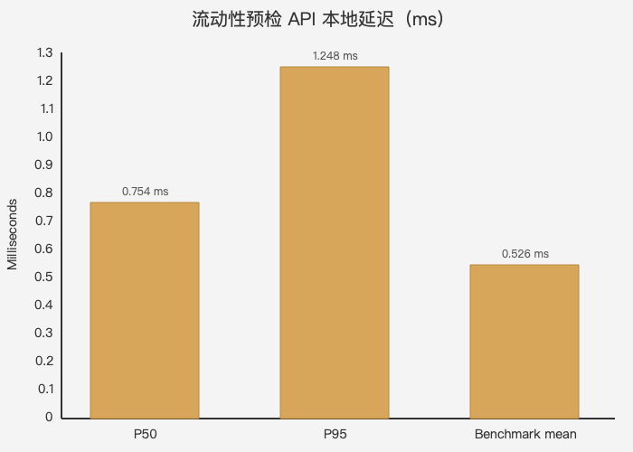

# 技术评测与竞品能力矩阵

> 评测日期：2026-11-01
>
> 可执行评测入口：[`benchmark/run.sh`](../benchmark/run.sh)
>
> 原始结果：[`latest.json`](../benchmark/results/latest.json) · [`latest-benchmark.txt`](../benchmark/results/latest-benchmark.txt)

## 1. 评测口径

这里分成两类证据，避免把公开页面介绍和可执行测试混成一个主观总分：

- **可执行评测**：直接启动 Go API 和 SQLite，验证安全不变量、幂等、审计、流动性黄金用例和延迟。
- **公开能力矩阵**：只比较官网、应用商店和官方新闻稿能证明的产品能力；竞品没有开放本地 API，因此不做无法复现的速度或安全排名。

## 2. 可执行评测指标

当前报告版本：`bankagent-eval-v2`。

| 指标 | 当前值 | 计算方式 |
| --- | ---: | --- |
| 评测检查通过率 | 8 / 8 | 未授权字段、提示注入、确认执行、幂等、黄金用例、替代方案、审计、确定性 |
| 安全不变量通过率 | 100.00% | 5 项安全检查全部通过 |
| 关键操作审计覆盖率 | 100.00% | 转账完整生命周期和流动性预检审计链 / 2 |
| 重复副作用 | 0 | 相同幂等键重放后账户余额变化次数 |
| 流动性黄金用例误差 | 0 minor | 保守情景不安全时期望最大预算 `0` 与实际值绝对差 |
| 流动性确定性 | PASS | 相同输入和数据生成完全一致的逐日曲线 |
| 延迟 P50 | 0.754 ms | 12 次本地 HTTP 请求中位数 |
| 延迟 P95 | 1.248 ms | 12 次本地 HTTP 请求 95 分位 |
| Go Benchmark | 0.526 ms/op | 2575 次 `BenchmarkLiquiditySimulationHTTP` 平均值 |
| 内存分配 | 204,518 B/op · 1417 allocs/op | 同一 Benchmark 的 `-benchmem` 结果 |



图表源文件：[`evaluation-latency.mmd`](../benchmark/evaluation-latency.mmd)。延迟是 Apple M5 / arm64 的本地 `httptest` 结果，只用于版本回归，不能直接外推到生产网络。

## 3. 专业指标含义

### Safety Invariant Pass Rate

检查服务端是否拒绝未知授权字段、提示注入是否无法自动执行动作、相同幂等键是否只产生一次副作用、保守情景不安全时是否阻止预算，以及推荐方案是否无条件且非 `unsafe`。当前 5 项全部通过。

### Audit Coverage

对成功转账读取统一 Action Trace，验证 `action_created → confirmation_succeeded → authorization_gate_passed → action_succeeded`；对流动性预检验证计算结果审计。当前覆盖 `2 / 2`。

### Golden Case Absolute Error

固定演示数据下，30 天流动性预检的保守情景最低余额为 `-670.00 CNY`，因此整体结论必须是 `unsafe`，最大安全预算为 `0`。评测要求实际结果与黄金值误差为 `0` 最小货币单位。

### Determinism

同一账户、同一时间、同一输入执行两次模拟，逐日曲线和事件列表必须完全一致。该指标用于验证模型不会参与数值预测。

### Latency P50/P95

分别反映典型请求和尾部请求的本地耗时；排序后取最近秩。它不替代真实网络压测，但能及时发现数据库查询、JSON 序列化或事件展开造成的性能回退。

## 4. 运行方式

```bash
./benchmark/run.sh
```

脚本会执行：

```text
go test -run TestExecutableEvaluationReport -v ./internal/httpapi
go test -run '^$' -bench BenchmarkLiquiditySimulationHTTP -benchmem ./internal/httpapi
```

结果写入 `benchmark/results/latest.json` 和 `benchmark/results/latest-benchmark.txt`。评测使用固定时间和临时 SQLite，可在本机重复运行。

## 5. 竞品公开能力矩阵

图例：`✓` 有明确公开证据；`◐` 有相邻能力但未披露完整动作链；`○` 没有找到公开证据。

| 能力 | Vaultline | Revolut AIR | Cleo | Copilot Money | Origin |
| --- | :---: | :---: | :---: | :---: | :---: |
| 对话内执行金融动作 | ✓ | ✓ | ◐ | ◐ | ◐ |
| 转账动作 | ✓ | ◐ | ○ | ○ | ○ |
| 账单分析 | ✓ | ◐ | ◐ | ✓ | ✓ |
| 理财申购/赎回 | ✓ | ◐ | ◐ | ◐ | ✓ |
| 卡片管理 | ✓ | ◐ | ◐ | ○ | ○ |
| 订阅管理 | ✓ | ◐ | ◐ | ✓ | ✓ |
| 跨场景任务规划 | ✓ | ◐ | ◐ | ◐ | ✓ |
| 流动性预检 | ✓ | ◐ | ◐ | ✓ | ◐ |
| 服务端动作快照 + MFA 绑定 | ✓ | ◐ | ○ | ◐ | ○ |
| 可验证审计与业务回执 | ✓ | ◐ | ○ | ◐ | ○ |

原始数据：[`capability-matrix.csv`](../benchmark/capability-matrix.csv)。

## 6. 评测结论

Vaultline 的差异化不是“模型更大”，而是三个可验证组合：

1. 六类银行业务统一进入服务端 Action 状态机，而不是只提供分析建议。
2. 确认、MFA、幂等、审计和工具回执可以通过 HTTP 测试直接验证。
3. 流动性预检提供逐日曲线、黄金用例误差和确定性验证，属于可执行金融算法，不是模型自由生成的建议。

## 7. 公开资料来源

| 产品 | 公开证据 |
| --- | --- |
| Revolut AIR | [Revolut Research 官方新闻稿](https://www.revolut.com/news/revolut_announces_launch_of_dedicated_ai_research_division_revolut_research/)、[Revolut App Store](https://apps.apple.com/us/app/revolut-send-spend-and-save/id932493382) |
| Cleo | [Cleo 官网](https://www.meetcleo.com/)、[Cleo App Store](https://apps.apple.com/us/app/cleo-ai-cash-advance-budget/id1447274646) |
| Copilot Money | [Copilot 官网](https://www.copilot.money/)、[Copilot App Store](https://apps.apple.com/us/app/copilot-track-budget-money/id1447330651) |
| Origin | [Origin 官网](https://useorigin.com/)、[Origin App Store](https://apps.apple.com/us/app/origin-ai-budget-and-track/id1637693312) |
| Vaultline | 当前仓库代码、测试、[OpenAPI](openapi.yaml)和[技术方案](技术方案.md) |

竞品内部可能存在未公开的执行、授权或审计能力；矩阵中的 `○` 只表示公开材料不足，不应解释为产品缺陷。
